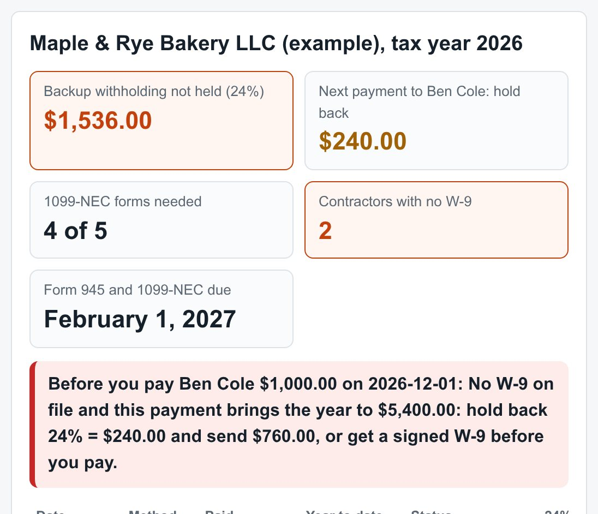

# 1099 tracker

[https://jmshinhwa.github.io/rulestamp-tools/1099-tracker-w9-backup-withholding/](https://jmshinhwa.github.io/rulestamp-tools/1099-tracker-w9-backup-withholding/)

## What it does

Which contractor payments needed 24% held back, and what to hold on the next one Example (made-up): Maple & Rye Bakery paid Ben Cole $2,700.00 after his 2026 total passed the $2,000 line with no W-9 on file, so the 24% backup withholding was never held and the bakery can lose $648.00 to the IRS, which can collect it from the payer. Across 5 contractors it left $1,536.00 unheld; before the next $1,000.00 payment the tracker says hold back $240.00, send $760.00. 1099 tracker for US small businesses, landlords and bookkeepers who pay contractors by check, ACH or Zelle. Log each payment once (date; contractor; amount; method) and the date each signed W-9 arrived. The page marks the payment that crosses the 2026 $2,000 line, applies the rule that the crossing payment and every later one are subject (Treas. Reg. 31.3406(b)(3)-1), drops the wait for contractors you had to send a 1099 for last year, and leaves card and PayPal payments to Form 1099-K. 7 inputs, 5 results: backup withholding not held, what to hold on the next payment, 1099-NEC forms needed, contractors with no W-9, Form 945 and 1099-NEC due date (February 1, 2027). Free: one business and one year, any number of contractors and payments, the whole answer on screen. It does not file Form 945 or 1099s and does not move money. Data stays in your browser. Not legal or tax advice.

## How to open

Open it in any browser: https://jmshinhwa.github.io/rulestamp-tools/1099-tracker-w9-backup-withholding/ — nothing to install, your entries stay in your browser. Offline: download this folder and open `index.html`.

## Result after one filled case

## Rule source and date

- The rule is the calculation printed on the page; page checked 2026-11-15.

Save and continue: https://getreadystack.com/apps/1099-tracker-w9-backup-withholding/
