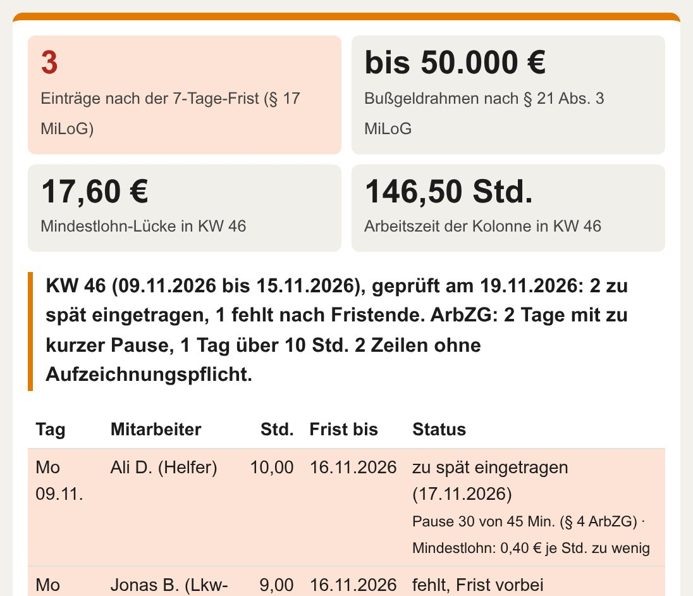

# Arbeitszeitnachweis vorlage Bau

[https://jmshinhwa.github.io/rulestamp-tools/arbeitszeitnachweis-vorlage-bau-7-tage-frist/](https://jmshinhwa.github.io/rulestamp-tools/arbeitszeitnachweis-vorlage-bau-7-tage-frist/)

## Was es macht

Wochen-Arbeitszeitnachweis der Kolonne: 7-Tage-Frist, Mindestlohn, Pausen geprüft Beispiel (erfunden): Eine Baukolonne in KW 46/2026. Die Stundenzettel kamen erst am 17.11.2026 ins Büro, für Montag, 09.11.2026, lief die Frist am 16.11.2026 ab. Ergebnis: 3 Einträge nach der 7-Tage-Frist (§ 17 Abs. 1 MiLoG), Bußgeldrahmen bis 50.000 € (§ 21 Abs. 3 MiLoG). Der Helfer mit 13,50 € je Stunde hat 17,60 € Mindestlohn-Lücke in dieser Woche, ab 01.01.2027 (14,60 €) wären es 48,40 €. Arbeitszeitnachweis vorlage für Bau-, Transport- und andere § 2a-Betriebe: Beginn, Ende, Pause und Baustelle je Mitarbeiter und Tag eintragen, dazu den Tag, an dem eingetragen wurde. Die Vorlage zeigt für jede Zeile das Fristende, wer nach MiLoDokV gar nicht aufzeichnen muss (Angehörige, über 4.461 € oder über 2.974 € seit 12 Monaten), den Mindestlohn je Tag nach Datum, zu kurze Pausen (§ 4 ArbZG), Tage über 10 Stunden (§ 3 ArbZG) und die Stunden je Baustelle. Läuft im Browser, ohne Konto, auch ohne Netz auf der Baustelle. Für wen: Inhaber und Büro kleiner Bau-, Transport-, Reinigungs- und Gastrobetriebe in Deutschland, die die Stundenzettel ihrer Leute führen. Was drin ist: 6 Branchen-Einstellungen, 3 Arten von Beschäftigten, 5 Status je Zeile, 4 Prüfungen je Tag (Frist, Mindestlohn, Pause, 10 Stunden), Stunden je Baustelle. Kostenlos: eine Woche der ganzen Kolonne komplett geprüft auf dem Bildschirm. Ein Rechner, keine Rechtsberatung.

## So öffnest du es

Im Browser öffnen: https://jmshinhwa.github.io/rulestamp-tools/arbeitszeitnachweis-vorlage-bau-7-tage-frist/ — nichts zu installieren, deine Eingaben bleiben in deinem Browser. Offline: diesen Ordner herunterladen und `index.html` öffnen.

## Ergebnis nach einem ausgefüllten Fall

## Regelquelle und Datum

- Die Regel ist die auf der Seite gedruckte Rechnung; Seite geprüft am 2026-11-19.

Speichern und weitermachen: https://getreadystack.com/de/apps/arbeitszeitnachweis-vorlage-bau-7-tage-frist/
