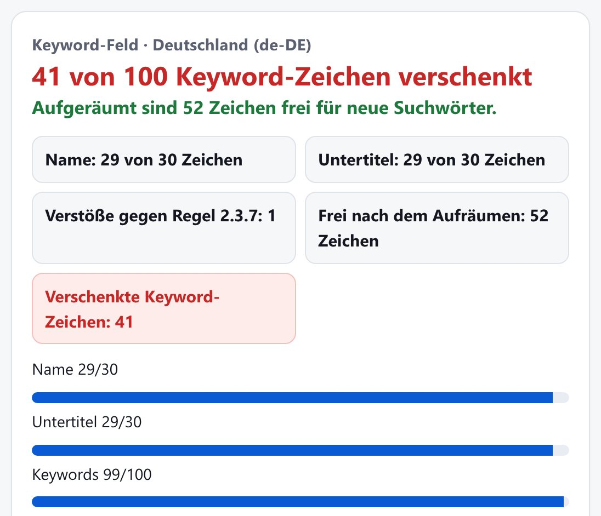

# ASO Tool — App-Store-Texte für de/ja/es/pt automatisch prüfen und schreiben

[https://jmshinhwa.github.io/rulestamp-tools/aso-tool/](https://jmshinhwa.github.io/rulestamp-tools/aso-tool/)

## Was es macht

ASO Tool: Name, Untertitel, Keywords nach Apples Regeln prüfen, in 5 Sprachen Beispiel (erfunden): Ein Haushaltsbuch füllt sein Keyword-Feld mit 99 Zeichen und verschenkt 41 davon: Wörter, die schon im Namen oder in der Kategorie stehen, ein doppeltes Wort und 11 Leerzeichen nach Kommas. Dazu „kostenlos“, eine Preisangabe gegen Apple-Regel 2.3.7. Aufgeräumt sind 52 Zeichen frei für neue Suchwörter. Für: iOS-Entwickler und kleine App-Studios, die ihre App in Deutschland, Japan, Spanien, Mexiko, Brasilien, Portugal, den USA oder Großbritannien verkaufen. Gratis: App-Store-ID eingeben, Name, Untertitel, Kategorie und Firmenname werden live aus dem Store gelesen; Ihr Keyword-Feld fügen Sie ein. Geprüft wird nach Apples eigenen Regeln: 30/30/100 Zeichen, Leerzeichen, Wiederholungen aus Name, Untertitel, Kategorie und Firmenname, Plural, Füllwörter, Preisangaben und fremde App-Namen (Regel 2.3.7) und ob der Store Ihre Beschreibung in seiner Sprache zeigt. Dazu das aufgeräumte Keyword-Feld zum Kopieren. Kein Angebot von Apple. Keine Suchvolumen- oder Ranking-Daten.

## So öffnest du es

Im Browser öffnen: https://jmshinhwa.github.io/rulestamp-tools/aso-tool/ — nichts zu installieren, deine Eingaben bleiben in deinem Browser. Offline: diesen Ordner herunterladen und `index.html` öffnen.

## Ergebnis nach einem ausgefüllten Fall

## Regelquelle und Datum

- Die Regel ist die auf der Seite gedruckte Rechnung; Seite geprüft am 2026-11-25.

Speichern und weitermachen: https://getreadystack.com/de/apps/aso-tool/
