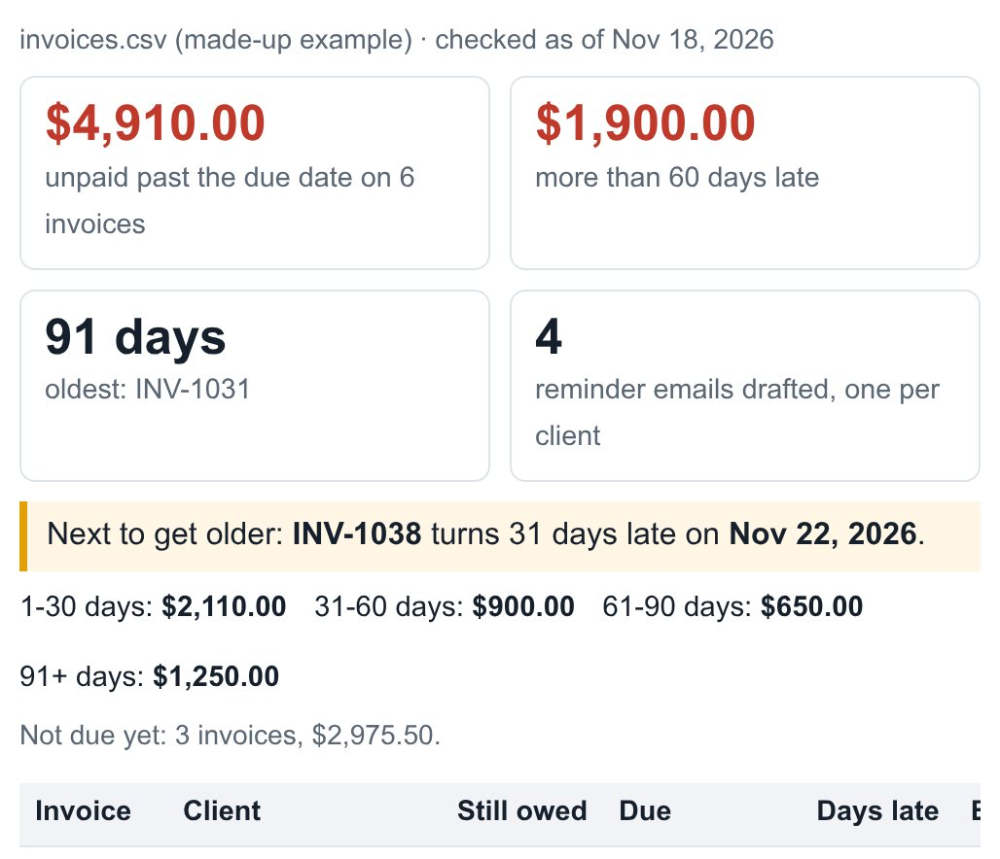

# automation scripts

[https://jmshinhwa.github.io/rulestamp-tools/automation-scripts-python-preview/](https://jmshinhwa.github.io/rulestamp-tools/automation-scripts-python-preview/)

## What it does

automation scripts: find unpaid invoices, dedupe contacts, sort files, previewed first Made-up example: a freelance designer's invoices.csv with 12 invoices, checked on Nov 18, 2026. The overdue invoices script finds $4,910.00 unpaid past the due date on 6 invoices, $1,900.00 of it more than 60 days late, and INV-1038 turns 31 days late on Nov 22, 2026. For: freelancers, small sellers and office workers who export invoices, contacts and bank transactions as CSV every week and do the same clean-up by hand. What is inside: 5 Python automation scripts. 1) Overdue invoices: days late, buckets 1-30/31-60/61-90/91+, the date each invoice moves up, one reminder draft per client. 2) Merge and dedupe contacts by email or phone, filling empty cells from the duplicates. 3) Bank transactions by category with your own rules, totals per month. 4) Rename and sort files into folders by type or month, with a plan first and an undo log. 5) Split one CSV into one file per client with totals. Free on the page: any script on your own file, every row, the whole result on screen. Nothing is uploaded.

## How to open

Open it in any browser: https://jmshinhwa.github.io/rulestamp-tools/automation-scripts-python-preview/ — nothing to install, your entries stay in your browser. Offline: download this folder and open `index.html`.

## Result after one filled case

## Rule source and date

- The rule is the calculation printed on the page; page checked 2026-11-18.

Save and continue: https://getreadystack.com/apps/automation-scripts-python-preview/
