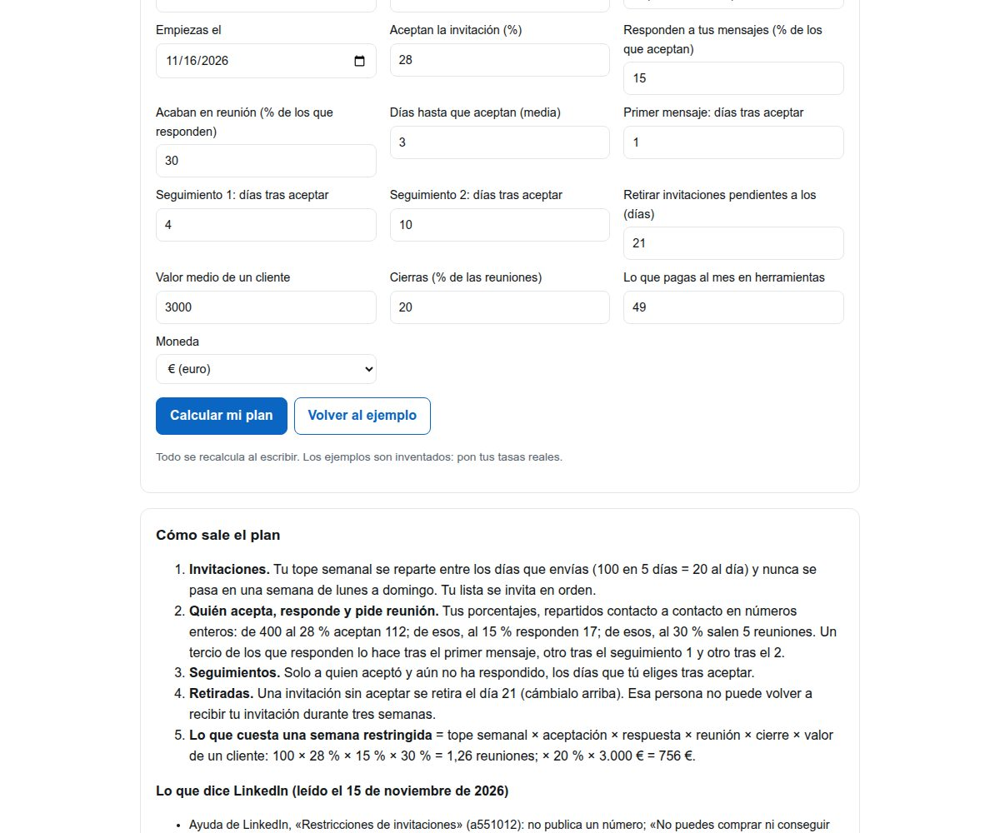

# automatización LinkedIn — planificador semanal de prospección

[https://jmshinhwa.github.io/rulestamp-tools/automatizacion-linkedin/](https://jmshinhwa.github.io/rulestamp-tools/automatizacion-linkedin/)

## Qué hace

Automatización de LinkedIn sin bot: tu lista de contactos repartida bajo tu tope de invitaciones, día a día, con las reuniones que salen de tus tasas (aceptan, responden, reunión). No se conecta a LinkedIn y no envía nada.

## Cómo abrirlo

Ábrelo en cualquier navegador: https://jmshinhwa.github.io/rulestamp-tools/automatizacion-linkedin/ — no hay nada que instalar, tus datos se quedan en tu navegador. Sin conexión: descarga esta carpeta y abre `index.html`.

## Resultado tras rellenar un caso

## Fuente de la regla y fecha

- Ayuda de LinkedIn «Restricciones de invitaciones» (a551012): https://www.linkedin.com/help/linkedin/answer/a551012?lang=es
- Ayuda de LinkedIn (a563153), notas personales sin Premium: https://www.linkedin.com/help/linkedin/answer/a563153
- Condiciones de uso de LinkedIn: https://es.linkedin.com/legal/user-agreement — leído el 15 de noviembre de 2026.

Guardar y continuar: https://getreadystack.com/es/apps/automatizacion-linkedin/
