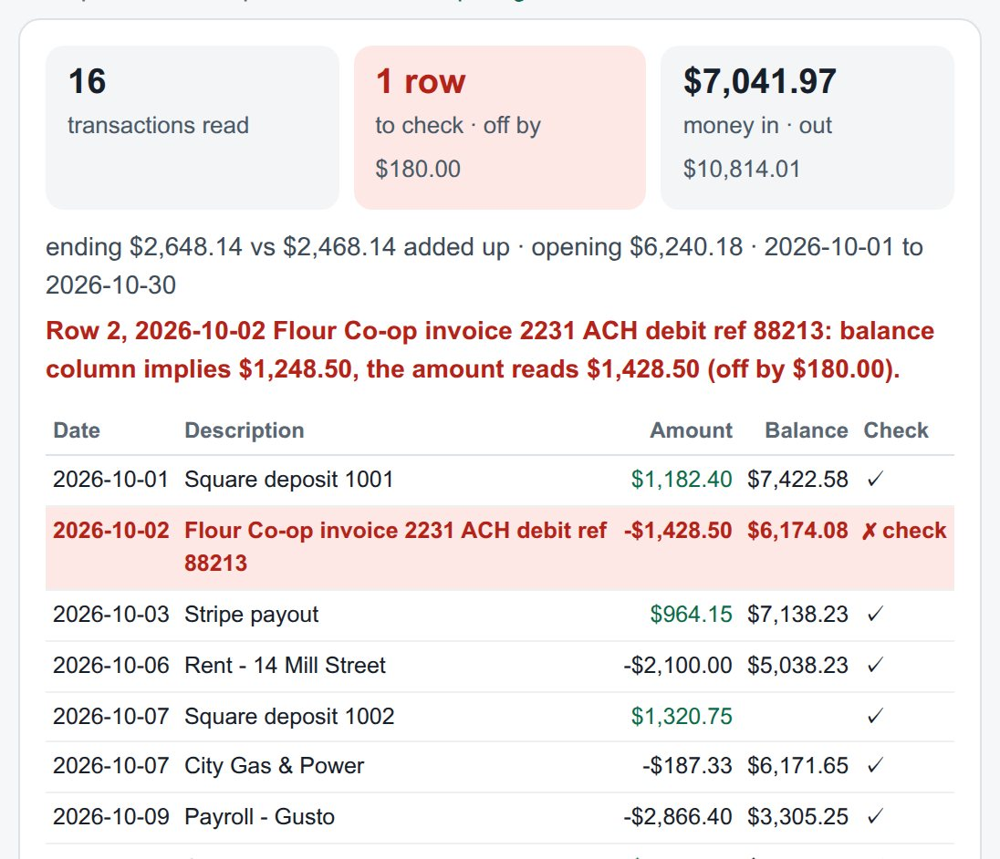

# Bank statement converter

[https://jmshinhwa.github.io/rulestamp-tools/bank-statement-converter/](https://jmshinhwa.github.io/rulestamp-tools/bank-statement-converter/)

## What it does

Bank statement converter: PDF to Excel, no upload, a misread row shows red Example (made-up): a bakery's October statement, 16 rows. One withdrawal was read as $1,428.50, but the balance column says $1,248.50. That leaves a $180.00 variance in the books. The converter re-adds the balance on every row and marks that row red, with what the balance implies. For bookkeepers, accountants and small business owners who turn PDF bank statements into spreadsheets for reconciliation, month-end and year-end. Your PDF is read inside your browser tab. It is never uploaded. Text PDFs from online banking, every page, every row; password-protected PDFs ask for their password. Dates like 10/02, 02/10/2026, 2026-10-02 or Oct 2; days with one printed balance are checked together; statements without a balance column are checked against the ending balance. Free: any statement converted into the full table on screen, with the balance check on every row. No page credits. Not read yet: scanned paper statements (images). A conversion and checking tool for your own records, not accounting or tax advice.

## How to open

Open it in any browser: https://jmshinhwa.github.io/rulestamp-tools/bank-statement-converter/ — nothing to install, your entries stay in your browser. Offline: download this folder and open `index.html`.

## Result after one filled case

## Rule source and date

- The rule is the calculation printed on the page; page checked 2026-11-26.

Save and continue: https://getreadystack.com/apps/bank-statement-converter/
