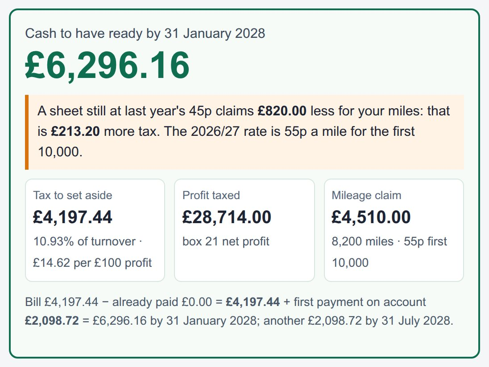

# bookkeeping spreadsheet for UK sole traders 2026/27

[https://jmshinhwa.github.io/rulestamp-tools/bookkeeping-spreadsheet-uk-sole-trader/](https://jmshinhwa.github.io/rulestamp-tools/bookkeeping-spreadsheet-uk-sole-trader/)

## What it does

bookkeeping spreadsheet: UK sole trader boxes, 55p mileage, January tax cash Example (made-up mobile hairdresser, 2026/27): £38,400.00 turnover and 8,200 business miles. The tax to set aside is £4,197.44, but 31 January 2028 needs £6,296.16 once HMRC's first payment on account is added; a sheet still at last year's 45p claims £820.00 less for those miles, so you overpay £213.20 in tax. For: UK self-employed sole traders (England, Wales, Northern Ireland) who keep their own books for Self Assessment. Free on the page, any numbers: the 13 SA103S boxes (9 to 21), the mileage claim at the 2026/27 rate (55p a mile for the first 10,000, 25p after, motorcycles 24p), profit, Income Tax and Class 4 NI to set aside, payments on account and the cash due on 31 January, the trading allowance check and your Making Tax Digital start date. A ledger you type into with running totals for the 4 MTD quarters. Tax years 2025/26 and 2026/27. Rates read on GOV.UK on 18 November 2026. No bank login, nothing to install. Record-keeping only, not tax advice.

## How to open

Open it in any browser: https://jmshinhwa.github.io/rulestamp-tools/bookkeeping-spreadsheet-uk-sole-trader/ — nothing to install, your entries stay in your browser. Offline: download this folder and open `index.html`.

## Result after one filled case

## Rule source and date

- The rule is the calculation printed on the page; page checked 2026-11-18.

Save and continue: https://getreadystack.com/apps/bookkeeping-spreadsheet-uk-sole-trader/
