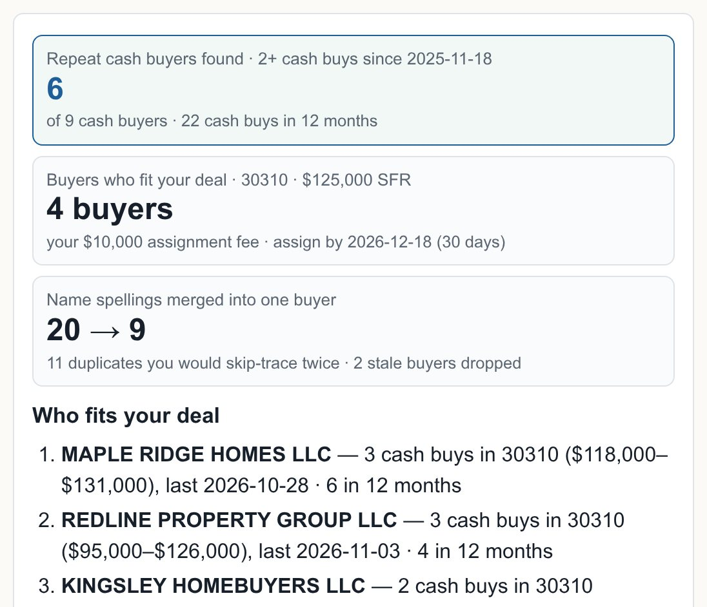

# cash buyers list

[https://jmshinhwa.github.io/rulestamp-tools/cash-buyers-list-finder/](https://jmshinhwa.github.io/rulestamp-tools/cash-buyers-list-finder/)

## What it does

Who bought cash in your deal's zip, one row per real investor, ranked Example (made-up): 35 recorded sales in Atlanta zips 30310, 30311 and 30314. Your deal in 30310 at $125,000 carries a $10,000 assignment fee that is lost if no buyer takes it by 2026-12-18, and only 4 buyers in the file bought cash in 30310 near that price. The raw list shows 20 buyer names; they are 9 buyers, so 11 would be skip-traced twice. Bought cash buyers lists go stale and repeat one investor under several LLC spellings. This builds the list from sales recorded in your own market: paste a sold-records CSV from your county recorder, Propwire, PropStream or the MLS. For real estate wholesalers and dispo managers in the US. 10 inputs. What it does: keeps cash sales (no loan, no lender), drops bank and agency deeds and transfers under $1,000, merges spellings and shared mailing addresses into one buyer, ranks repeat cash buyers by buys in the last 6, 12 or 24 months, moves buyers with no recent buy to a stale line, and lists who fits your deal by zip, price and property type. Free: one export, the whole ranked list and the deal match on screen, any number of rows. No account; the file stays in your browser. It does not sell data or skip-trace.

## How to open

Open it in any browser: https://jmshinhwa.github.io/rulestamp-tools/cash-buyers-list-finder/ — nothing to install, your entries stay in your browser. Offline: download this folder and open `index.html`.

## Result after one filled case

## Rule source and date

- The rule is the calculation printed on the page; page checked 2026-11-18.

Save and continue: https://getreadystack.com/apps/cash-buyers-list-finder/
