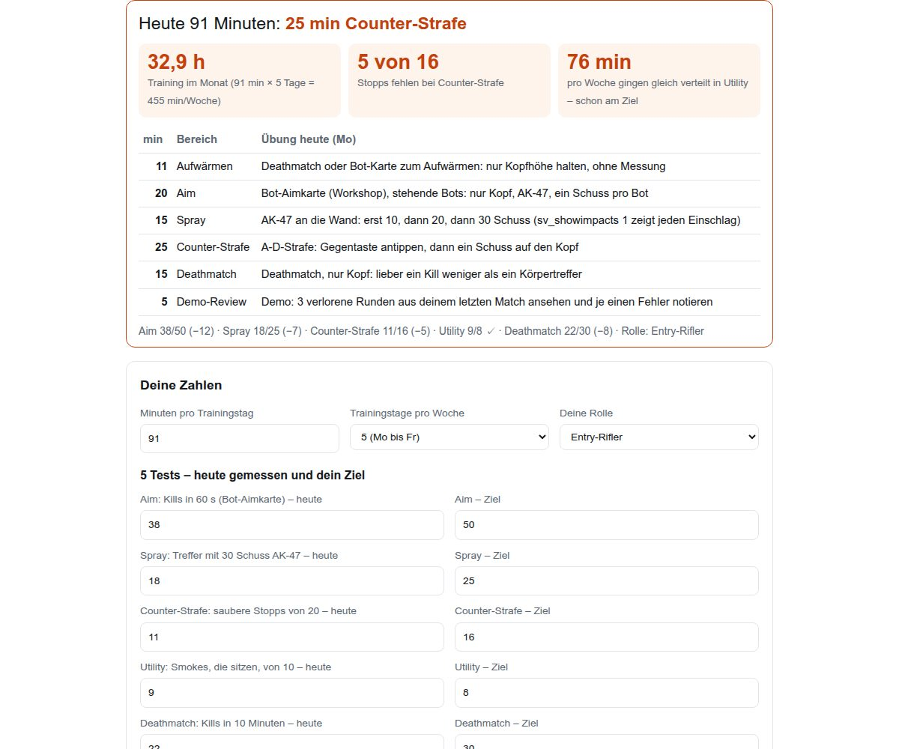

# CS2 Training Routine

[https://jmshinhwa.github.io/rulestamp-tools/cs2-training-routine/](https://jmshinhwa.github.io/rulestamp-tools/cs2-training-routine/)

## Was es macht

Aus 5 kurzen Tests im eigenen CS2 (Aim, Spray, Counter-Strafe, Utility, Deathmatch) und deinen Minuten pro Tag macht der Plan eine Woche: die Minuten gehen dorthin, wo dir am meisten zum Ziel fehlt, mit den Konsolenbefehlen für die Übung.

## So öffnest du es

Im Browser öffnen: https://jmshinhwa.github.io/rulestamp-tools/cs2-training-routine/ — nichts zu installieren, deine Eingaben bleiben in deinem Browser. Offline: diesen Ordner herunterladen und `index.html` öffnen.

## Ergebnis nach einem ausgefüllten Fall

## Regelquelle und Datum

- Die Regel ist die auf der Seite gedruckte Planungsregel (Aufwärmen 10 %, Demo-Review ab 40 Minuten 8 %, Rest nach Lücke zum Ziel); keine Aussage von Valve. Seite geprüft am 15.11.2026.

Speichern und weitermachen: https://getreadystack.com/de/apps/cs2-training-routine/
