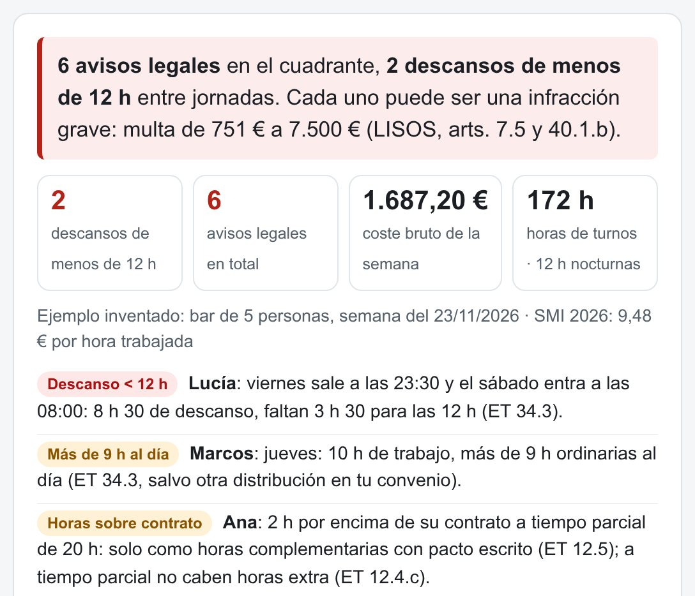

# cuadrante turnos

[https://jmshinhwa.github.io/rulestamp-tools/cuadrante-turnos-descanso-12-horas-coste/](https://jmshinhwa.github.io/rulestamp-tools/cuadrante-turnos-descanso-12-horas-coste/)

## Qué hace

cuadrante turnos: ve cada descanso de menos de 12 h y el coste de la semana Ejemplo inventado: un bar de 5 personas con 172 h de turnos y 1.687,20 € de coste bruto a la semana tiene 2 descansos de menos de 12 h entre jornadas (Lucía cierra el viernes a las 23:30 y abre el sábado a las 08:00: 8 h 30) y 6 avisos legales en total; cada uno puede ser una infracción grave con una multa de 751 € a 7.500 € (LISOS, arts. 7.5 y 40.1.b). Escribes los turnos como en el tablón (8-16, 10-14/18-22, L) o los pegas desde Excel y ves qué incumple el Estatuto de los Trabajadores y cuánto cuesta la semana. Para quién: bares, tiendas, residencias y equipos pequeños en España que hacen el cuadrante a mano. Qué revisa: descanso de 12 h entre jornadas (ET 34.3), más de 9 h al día, pausa en tramos de más de 6 h, día y medio semanal (ET 37.1), horas sobre el contrato, menores de noche, € por hora frente al SMI 2026 (9,48 €/h) y personas por día. Gratis: la revisión completa de una semana en pantalla, sin límite de personas. Sin registro, los datos se quedan en tu navegador. Fuentes: BOE, leídas el 20/11/2026. No es asesoramiento legal: tu convenio puede cambiar los límites.

## Cómo abrirlo

Ábrelo en cualquier navegador: https://jmshinhwa.github.io/rulestamp-tools/cuadrante-turnos-descanso-12-horas-coste/ — no hay nada que instalar, tus datos se quedan en tu navegador. Sin conexión: descarga esta carpeta y abre `index.html`.

## Resultado tras rellenar un caso

## Fuente de la regla y fecha

- La regla es el cálculo impreso en la página; página revisada el 2026-11-20.

Guardar y continuar: https://getreadystack.com/es/apps/cuadrante-turnos-descanso-12-horas-coste/
