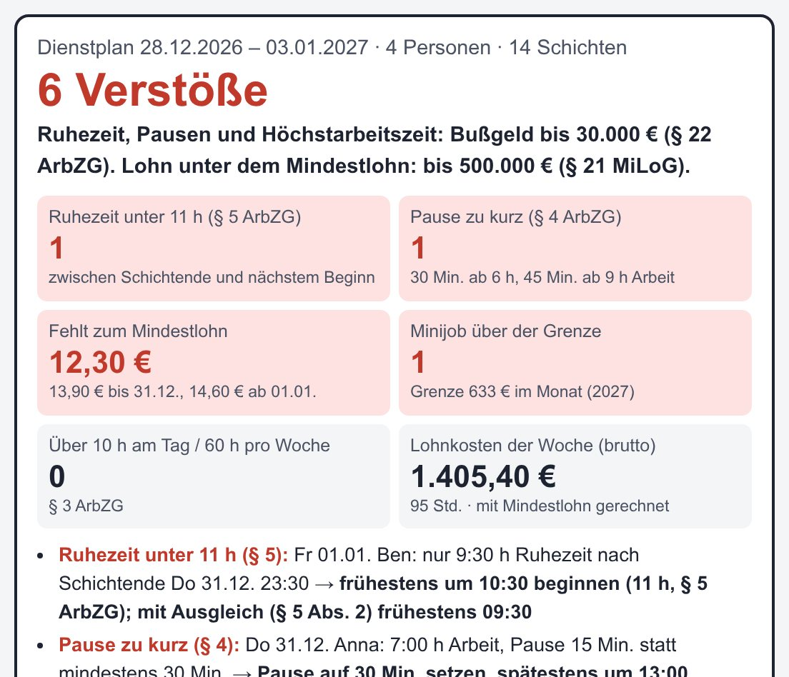

# Dienstplan erstellen

[https://jmshinhwa.github.io/rulestamp-tools/dienstplan-erstellen/](https://jmshinhwa.github.io/rulestamp-tools/dienstplan-erstellen/)

## Was es macht

Dienstplan erstellen: Ruhezeit, Pausen und Mindestlohn 2027 je Schicht geprüft Beispiel (erfunden): Ein Café mit 4 Leuten plant die Woche 28.12.2026 – 03.01.2027. Ben schließt an Silvester um 23:30 und soll an Neujahr um 09:00 öffnen: nur 9:30 h Ruhezeit statt 11 h, ein Verstoß gegen § 5 ArbZG mit Bußgeld bis 30.000 €. Mit 14,00 € Stundenlohn liegt er ab 01.01.2027 unter dem Mindestlohn von 14,60 €. Für: Inhaber und Schichtleiter in Café, Restaurant, Bäckerei, Laden oder Pflegedienst in Deutschland mit 2 bis 30 Leuten, die den Wochenplan selbst schreiben. Gratis: Eine Woche mit allen Personen und Schichten. Jede Schicht wird gegen Ruhezeit (§ 5 ArbZG), Pausen (§ 4), 10-Stunden-Grenze (§ 3), Mindestlohn nach Datum und Minijob-Grenze geprüft, mit der frühesten erlaubten Uhrzeit und den Lohnkosten der Woche. Ohne Anmeldung, Daten nur im Browser. Keine Zeiterfassung per Stempeluhr, keine Mitarbeiter-App. Planning tool only, not legal advice.

## So öffnest du es

Im Browser öffnen: https://jmshinhwa.github.io/rulestamp-tools/dienstplan-erstellen/ — nichts zu installieren, deine Eingaben bleiben in deinem Browser. Offline: diesen Ordner herunterladen und `index.html` öffnen.

## Ergebnis nach einem ausgefüllten Fall

## Regelquelle und Datum

- Die Regel ist die auf der Seite gedruckte Rechnung; Seite geprüft am 2026-11-20.

Speichern und weitermachen: https://getreadystack.com/de/apps/dienstplan-erstellen/
