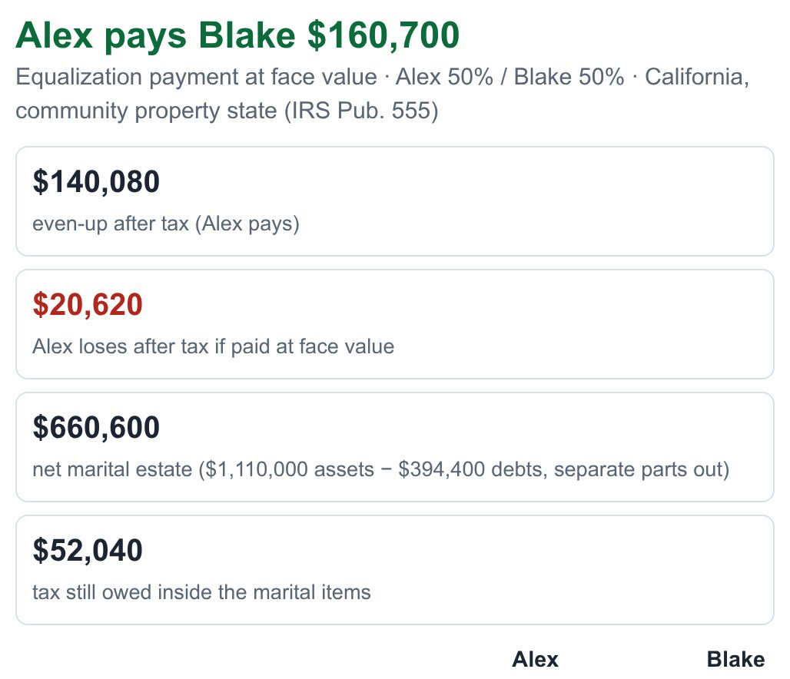

# divorce asset division calculator

[https://jmshinhwa.github.io/rulestamp-tools/divorce-asset-division-calculator/](https://jmshinhwa.github.io/rulestamp-tools/divorce-asset-division-calculator/)

## What it does

divorce asset division calculator: who pays whom, at face value and after tax Example (made-up): Alex and Blake in California split $660,600 of marital property 50/50. Alex keeps the house and the 401(k) and pays Blake $160,700, then walks away with $20,620 less than half after tax, because that 401(k) still owes $46,640 in income tax. For: spouses in any US state working out who keeps what, and the mediators and family-law attorneys who build the balance sheet with them. What it computes: net marital estate, each spouse's target share (50/50 in the 9 community property states listed in IRS Publication 555, your own percent in equitable distribution states), separate property set apart row by row (whole item or just the part owned before the wedding), the equalization payment at face value, the tax still built into each item (pre-tax retirement, brokerage gain, home gain above the exclusion), the payment after tax, and what each spouse walks away with. Free on the page: one case, any number of assets and debts, the whole division on screen. One case: $49 once. Mediators and attorneys: $29 per month, unlimited client cases. No sign-up; data stays in your browser. A calculation tool for your own numbers, not legal or tax advice.

## How to open

Open it in any browser: https://jmshinhwa.github.io/rulestamp-tools/divorce-asset-division-calculator/ — nothing to install, your entries stay in your browser. Offline: download this folder and open `index.html`.

## Result after one filled case

## Rule source and date

- The rule is the calculation printed on the page; page checked 2026-11-18.

Save and continue: https://getreadystack.com/apps/divorce-asset-division-calculator/
