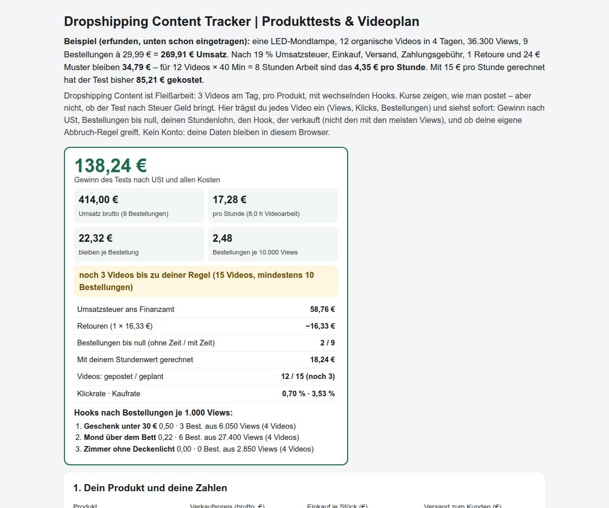

# Dropshipping Content Tracker

[https://jmshinhwa.github.io/rulestamp-tools/dropshipping-content-tracker/](https://jmshinhwa.github.io/rulestamp-tools/dropshipping-content-tracker/)

## Was es macht

Was dein organischer Produkttest nach 19 % Umsatzsteuer wirklich bringt: Umsatz, Einkauf, Versand, Zahlungsgebühr, Retouren und Muster pro Bestellung und pro Stunde Arbeit, dazu der Videoplan für die Testtage.

## So öffnest du es

Im Browser öffnen: https://jmshinhwa.github.io/rulestamp-tools/dropshipping-content-tracker/ — nichts zu installieren, deine Eingaben bleiben in deinem Browser. Offline: diesen Ordner herunterladen und `index.html` öffnen.

## Ergebnis nach einem ausgefüllten Fall

## Regelquelle und Datum

- § 12 UStG (Steuersätze): https://www.gesetze-im-internet.de/ustg_1980/__12.html
- § 19 UStG (Kleinunternehmer): https://www.gesetze-im-internet.de/ustg_1980/__19.html
- § 355 BGB (14 Tage Widerruf): https://www.gesetze-im-internet.de/bgb/__355.html — gelesen am 15.11.2026.

Speichern und weitermachen: https://getreadystack.com/de/apps/dropshipping-content-tracker/
