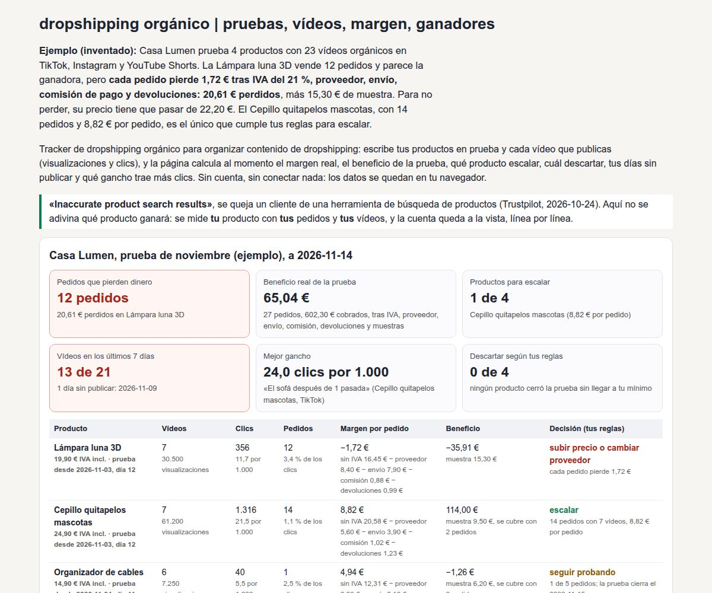

# dropshipping orgánico — pruebas, vídeos, margen

[https://jmshinhwa.github.io/rulestamp-tools/dropshipping-organico-pruebas-videos-margen/](https://jmshinhwa.github.io/rulestamp-tools/dropshipping-organico-pruebas-videos-margen/)

## Qué hace

Margen real por pedido en una prueba de dropshipping orgánico (sin anuncios): IVA, proveedor, envío, comisión de pago y devoluciones; qué producto escalar y cuál es tu mejor gancho de vídeo.

## Cómo abrirlo

Ábrelo en cualquier navegador: https://jmshinhwa.github.io/rulestamp-tools/dropshipping-organico-pruebas-videos-margen/ — no hay nada que instalar, tus datos se quedan en tu navegador. Sin conexión: descarga esta carpeta y abre `index.html`.

## Resultado tras rellenar un caso

## Fuente de la regla y fecha

- IVA general del 21 % en España: art. 90 Ley 37/1992 — https://www.boe.es/buscar/act.php?id=BOE-A-1992-28740
- Página revisada el 15-11-2026.

Guardar y continuar: https://getreadystack.com/es/apps/dropshipping-organico-pruebas-videos-margen/
