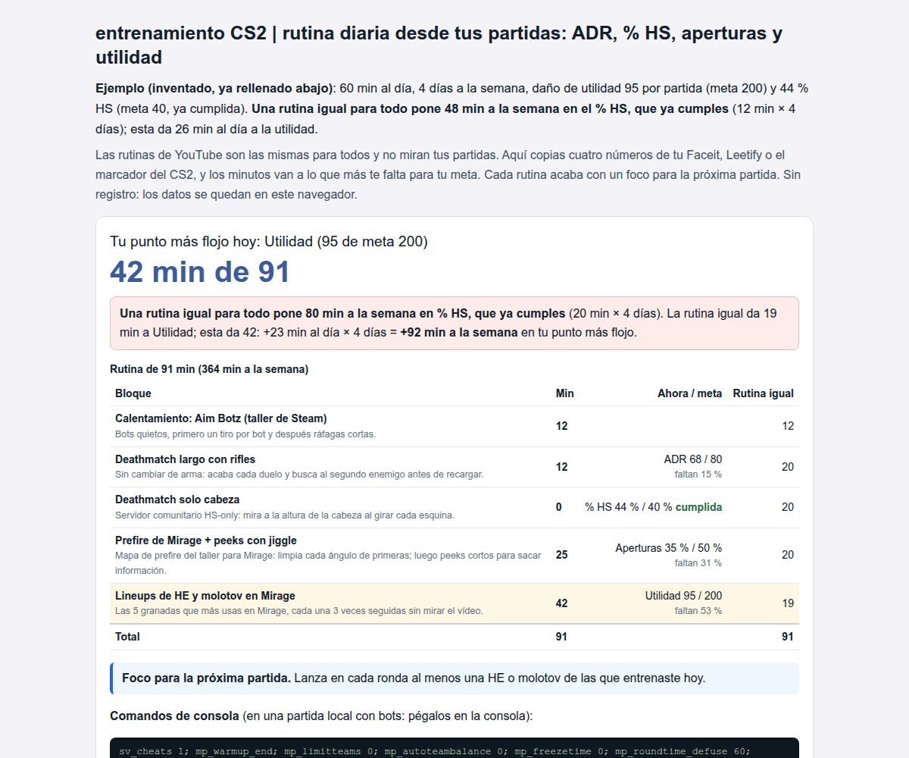

# entrenamiento CS2 — rutina diaria desde tus partidas

[https://jmshinhwa.github.io/rulestamp-tools/entrenamiento-cs2/](https://jmshinhwa.github.io/rulestamp-tools/entrenamiento-cs2/)

## Qué hace

Pon tus números de partida (ADR, % HS, aperturas, daño de utilidad) y tus metas; la rutina de hoy reparte tus minutos según lo que más te falta y te da los comandos de consola para practicarlo.

## Cómo abrirlo

Ábrelo en cualquier navegador: https://jmshinhwa.github.io/rulestamp-tools/entrenamiento-cs2/ — no hay nada que instalar, tus datos se quedan en tu navegador. Sin conexión: descarga esta carpeta y abre `index.html`.

## Resultado tras rellenar un caso

## Fuente de la regla y fecha

- La regla es el reparto impreso en la página (minutos según la distancia a cada meta); no es una regla de Valve. Página revisada el 15-11-2026.

Guardar y continuar: https://getreadystack.com/es/apps/entrenamiento-cs2/
