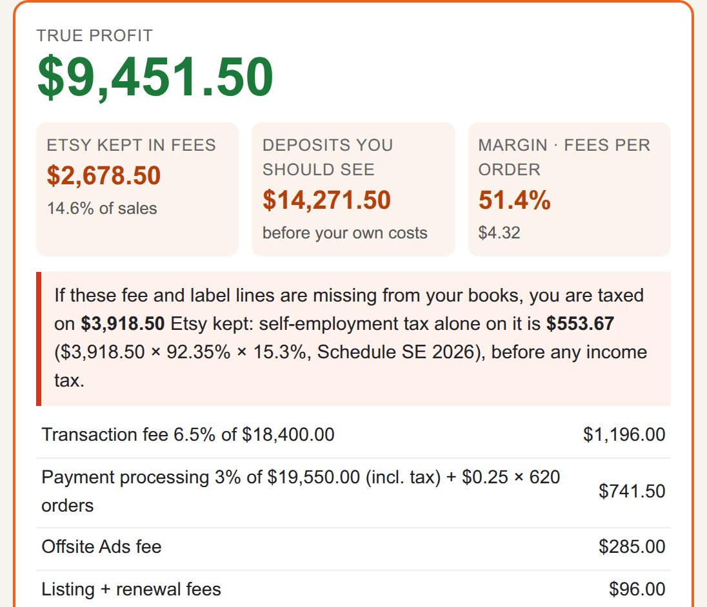

# Etsy bookkeeping spreadsheet 2027

[https://jmshinhwa.github.io/rulestamp-tools/etsy-bookkeeping-spreadsheet/](https://jmshinhwa.github.io/rulestamp-tools/etsy-bookkeeping-spreadsheet/)

## What it does

Etsy bookkeeping spreadsheet: every Etsy fee by country, true profit, Schedule C Example (made-up US shop, 2026): $18,400.00 sales, 620 orders. Etsy kept $2,678.50 in fees (6.5% transaction $1,196.00, processing $741.50, Offsite Ads $285.00, listing $96.00, Etsy Ads $360.00) plus $1,240.00 in labels. True profit: $9,451.50. If those $3,918.50 are missing from your books, self-employment tax alone on them is $553.67. For: Etsy sellers in the US, UK, Canada, Australia and the EU who keep their own books and want Etsy seller bookkeeping without typing each order. Free on the page, any numbers: every Etsy fee line at your bank country's rates (6.5% transaction, processing 3% + $0.25 US / 4% + £0.20 UK / 4% + €0.30 EU, regulatory fee for 6 of the countries listed, Offsite Ads 15% or 12%, listing, Ads), labels, the deposits you should see, true profit and margin, and the 2026 Schedule C lines (1, 2, 4, 8, 10, 22, 27b, 31). No sign-up: data stays in your browser. Fee rates read on Etsy Help 2026-11-15. A record-keeping tool, not tax advice. Not affiliated with Etsy, Inc.

## How to open

Open it in any browser: https://jmshinhwa.github.io/rulestamp-tools/etsy-bookkeeping-spreadsheet/ — nothing to install, your entries stay in your browser. Offline: download this folder and open `index.html`.

## Result after one filled case

## Rule source and date

- The rule is the calculation printed on the page; page checked 2026-11-15.

Save and continue: https://getreadystack.com/apps/etsy-bookkeeping-spreadsheet/
