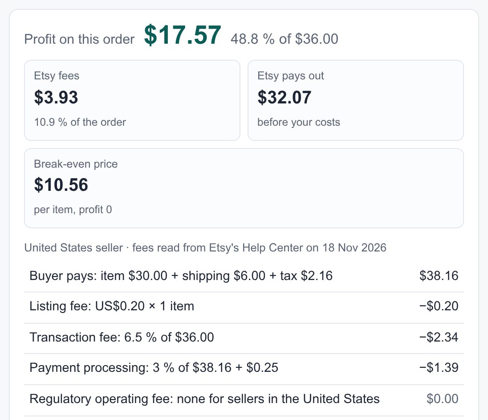

# Etsy Fee Calculator

[https://jmshinhwa.github.io/rulestamp-tools/etsy-fee-calculator/](https://jmshinhwa.github.io/rulestamp-tools/etsy-fee-calculator/)

## What it does

Etsy fees for your country and the profit you keep, per sale and per month Example (made up): a $30 mug with $6 shipping, sold from the US with 6 % sales tax: Etsy fees take $3.93 (listing $0.20, transaction $2.34, processing $1.39), you keep $17.57 after $14.50 of costs, and if the order came through an Offsite Ad another $5.40 is gone. For Etsy sellers in the US, UK, Canada, Australia, Germany, France, Spain, Italy, the Netherlands, Ireland, India and Türkiye. Inside: fees for 12 seller countries read from Etsy's Help Center on 18 Nov 2026, including the regulatory operating fees in force since 22 June 2026 and VAT on fees; break-even price and the price for your target margin; a reader for Etsy's monthly statement CSV that sorts every line into 15 line types (9 of them Etsy fees) and checks them against the Net column; a reader for the Order Items CSV that turns your unit costs into cost of goods. Free on the page: the full fee breakdown, profit, break-even and target price for any sale, as often as you like. Files are read in your browser and not uploaded. Not tax or accounting advice. Not affiliated with Etsy, Inc.

## How to open

Open it in any browser: https://jmshinhwa.github.io/rulestamp-tools/etsy-fee-calculator/ — nothing to install, your entries stay in your browser. Offline: download this folder and open `index.html`.

## Result after one filled case

## Rule source and date

- The rule is the calculation printed on the page; page checked 2026-11-18.

Save and continue: https://getreadystack.com/apps/etsy-fee-calculator/
