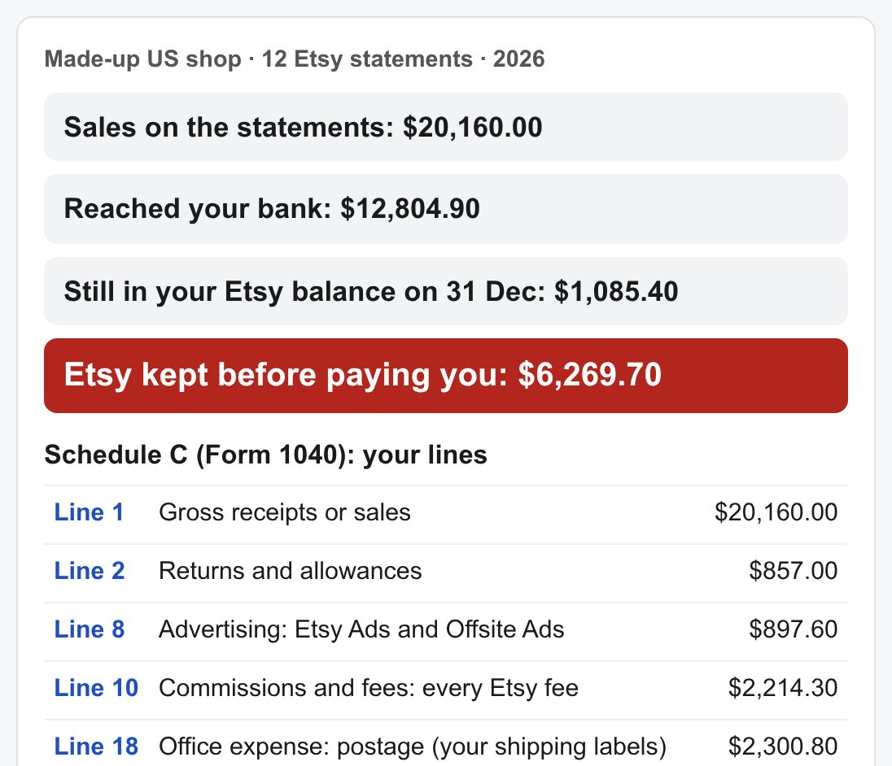

# Etsy seller tax spreadsheet — fees, 1099-K & Schedule C (US · Canada T2125 · UK)

[https://jmshinhwa.github.io/rulestamp-tools/etsy-seller-tax-spreadsheet-fees-1099-k-schedule-c-us-canada/](https://jmshinhwa.github.io/rulestamp-tools/etsy-seller-tax-spreadsheet-fees-1099-k-schedule-c-us-canada/)

## What it does

Etsy statements sorted onto Schedule C, T2125 or SA103S lines, fee by fee Made-up example: 12 Etsy statements for 2026 show $20,160.00 in sales, but only $12,804.90 reached the bank. Etsy kept $6,269.70 in fees, ads, shipping labels and money sent back to buyers. Each dollar has its Schedule C line; leave them off and you overpay tax on $6,269.70 you never kept. For Etsy sellers in the US (Schedule C), Canada (T2125) and the UK (SA103S for 2025 to 2026, due online by 31 January 2027). Drop your Etsy monthly statement CSV files, all 12 at once. Every line is sorted: Etsy fees by type, fee credits, Etsy Ads, Offsite Ads, shipping labels, money sent back to buyers and sales tax Etsy collected. The totals land on your lines: Schedule C 1, 2, 8, 10 and 18; T2125 8521, 8871, 9270 and 9275; SA103S boxes 9 and 17 to 20. Then it checks the 1099-K line (over $20,000 in more than 200 transactions), the C$30,000 GST/HST line, or the £1,000 trading allowance against your real costs. Free on screen, any number of statements, month by month. No sign-up; read in your browser. Tax workbook, one payment: an .xlsx file for Excel and Google Sheets with live formulas, every statement line, a 1099-K tab for boxes 5a to 5l, an Other costs tab and a one-page summary to print. Sorts your own statements; not tax advice. Not made by Etsy, Inc.

## How to open

Open it in any browser: https://jmshinhwa.github.io/rulestamp-tools/etsy-seller-tax-spreadsheet-fees-1099-k-schedule-c-us-canada/ — nothing to install, your entries stay in your browser. Offline: download this folder and open `index.html`.

## Result after one filled case

## Rule source and date

- The rule is the calculation printed on the page; page checked 2026-11-26.

Save and continue: https://getreadystack.com/apps/etsy-seller-tax-spreadsheet-fees-1099-k-schedule-c-us-canada/
