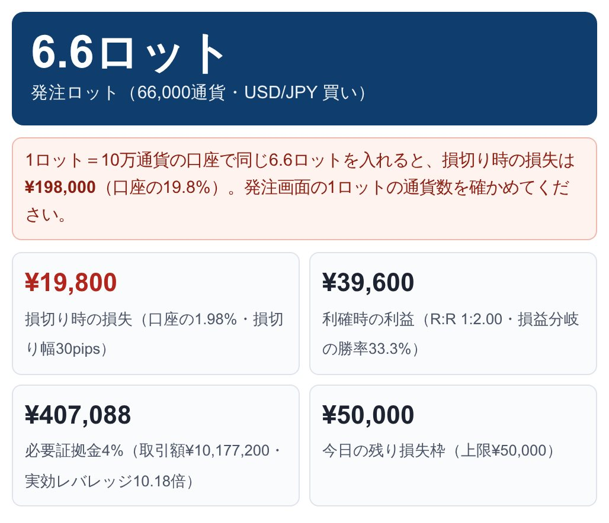

# FX ロット計算

[https://jmshinhwa.github.io/rulestamp-tools/fx-lot-keisan-kiroku/](https://jmshinhwa.github.io/rulestamp-tools/fx-lot-keisan-kiroku/)

## できること

FX ロット計算：損切り価格から発注ロット、今日の損失を次のロットに自動で反映 記入例（架空）：口座100万円・許容損失2%・USD/JPY 154.20で買い・損切り153.90 → 発注6.6ロット、損切り時の損失¥19,800。同じ6.6ロットを1ロット＝10万通貨の口座で入れると¥198,000（口座の19.8%）が一度に消えます。 対象：日本のFX口座でトレードする個人（1ロット1,000/1万/10万通貨・証拠金4%）。 計算するもの：損切り幅pips、許容損失、1ロットの損失、発注ロット（最小単位で切り捨て）、損切り時の損失、利確時の利益とR:R、損益分岐の勝率、必要証拠金4%と実効レバレッジ、10万通貨口座で同じロットを入れた場合の損失、1日の損失上限の残り。通貨ペア17種、円以外のペアは決済通貨の円レートを自分で入れる（レート取得の失敗なし）。 無料：1回のトレードの答えを画面でぜんぶ。 登録不要、データはブラウザの中だけ。ご自身の数字を記録・計算する道具で、投資助言ではありません。

## 開き方

ブラウザで開く: https://jmshinhwa.github.io/rulestamp-tools/fx-lot-keisan-kiroku/ — インストール不要、入力はブラウザ内に残ります。オフライン: このフォルダをダウンロードして `index.html` を開く。

## 1件入力した結果

## ルールの出典と日付

- ルールはページに表示された計算式です（2026-11-19 確認）。

保存して続ける: https://getreadystack.com/ja/apps/fx-lot-keisan-kiroku/
