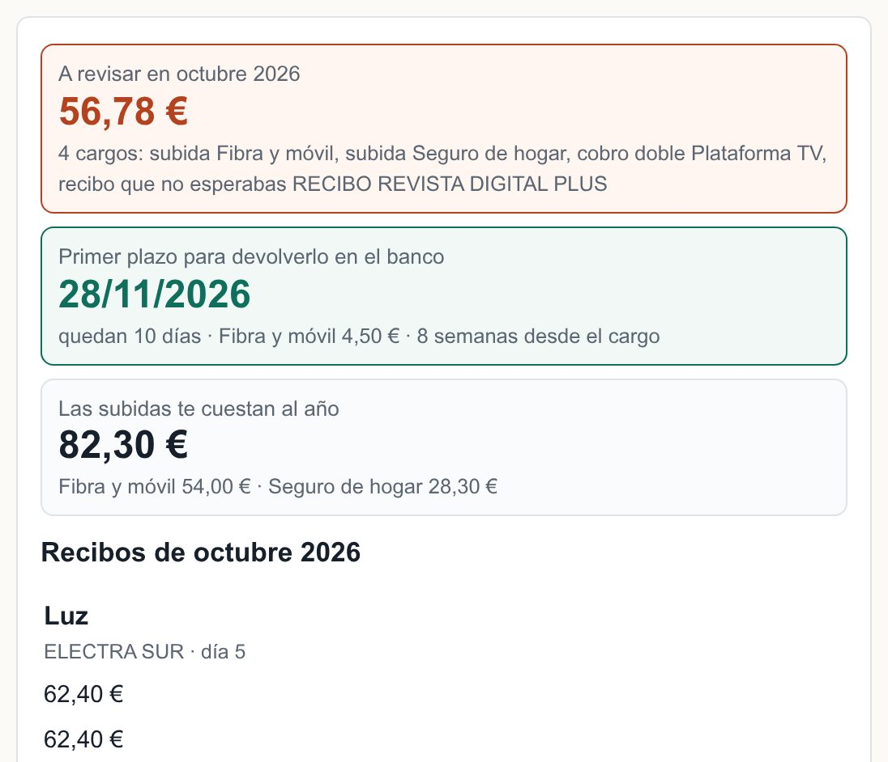

# gastos mensuales Excel

[https://jmshinhwa.github.io/rulestamp-tools/gastos-mensuales-excel-control-recibos/](https://jmshinhwa.github.io/rulestamp-tools/gastos-mensuales-excel-control-recibos/)

## Qué hace

Qué recibo subió, cuál se cobró dos veces y hasta cuándo devolverlo Ejemplo (inventado): 8 recibos domiciliados de un hogar en España, octubre de 2026: la fibra sube de 45,00 € a 49,50 € y el seguro de hogar de 186,30 € a 214,60 €, una pérdida de 82,30 € al año; además la TV se cobra dos veces y entra un recibo de 9,99 € que no esperabas: 56,78 € a revisar. El primer plazo para devolverlo en el banco acaba el 28/11/2026. Una plantilla de gastos mensuales en Excel suma 49,50 € igual que 45,00 €. Aquí cada cargo del banco se compara con el recibo que esperabas y lleva su fecha límite: 8 semanas desde el cargo (art. 49.1 RDL 19/2018). Para hogares y autónomos en España con luz, fibra, seguros, comunidad y suscripciones domiciliadas. 5 inputs (mes, fecha de hoy, margen de subida, tus recibos, cargos del banco). 4 avisos: subida, cobro doble, recibo que no esperabas, recibo sin cargo. Gratis: un mes completo en pantalla, con todos los recibos que quieras y el plazo de cada cargo marcado. Sin cuenta ni conexión al banco: los datos se quedan en tu navegador. Herramienta de cálculo; no es asesoramiento.

## Cómo abrirlo

Ábrelo en cualquier navegador: https://jmshinhwa.github.io/rulestamp-tools/gastos-mensuales-excel-control-recibos/ — no hay nada que instalar, tus datos se quedan en tu navegador. Sin conexión: descarga esta carpeta y abre `index.html`.

## Resultado tras rellenar un caso

## Fuente de la regla y fecha

- La regla es el cálculo impreso en la página; página revisada el 2026-11-18.

Guardar y continuar: https://getreadystack.com/es/apps/gastos-mensuales-excel-control-recibos/
