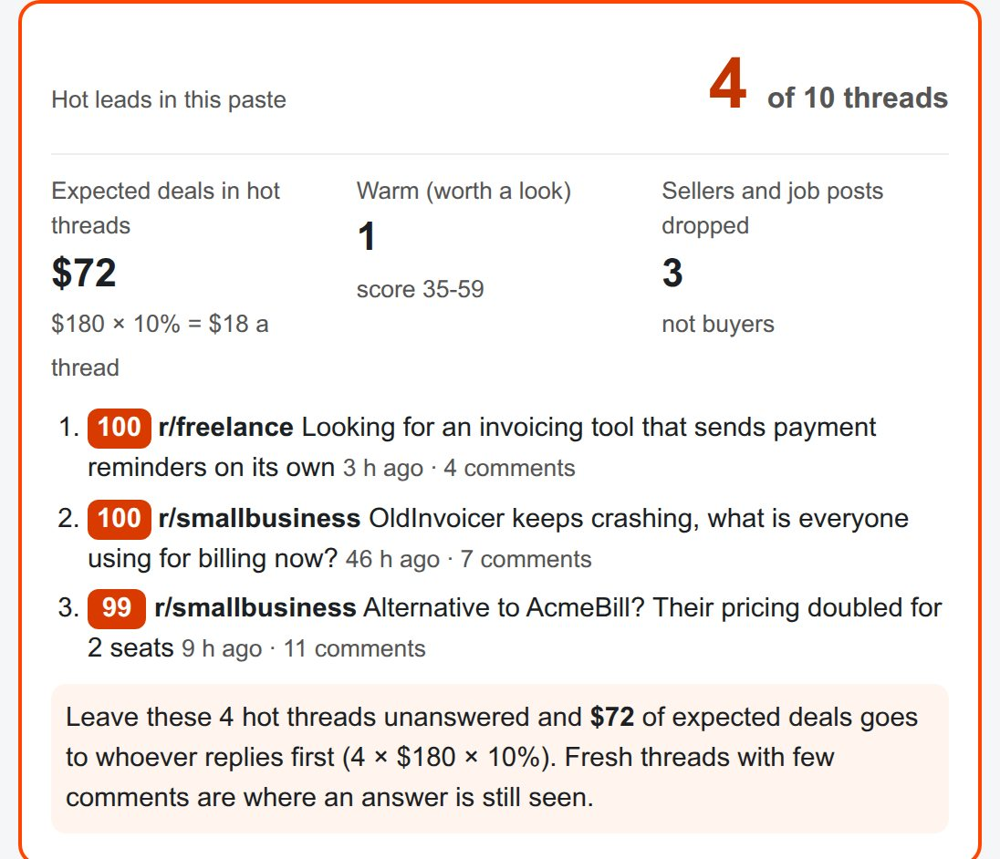

# lead generation on Reddit: thread scorer + lead tracker

[https://jmshinhwa.github.io/rulestamp-tools/lead-generation-reddit-thread-scorer/](https://jmshinhwa.github.io/rulestamp-tools/lead-generation-reddit-thread-scorer/)

## What it does

lead generation on Reddit: every thread scored for buying intent, with the reasons Example (made-up invoicing app, 10 Reddit threads): 4 threads score hot because someone asks for a tool, 3 are other founders selling or hiring. At a $180 deal and a 10% close rate those 4 threads hold $72 of expected deals; unanswered, it goes to whoever replies first. For: founders, indie hackers and marketers who find customers on Reddit by hand and want to stop reading 100 threads to answer 4. Free on the page, any number of threads: paste a Reddit search (its JSON, a Reddit .rss feed, or the text you copied from the search page) and every thread gets a 0-100 score with the reason for each point: your keywords, competitors you named, ask words in 5 languages (en, de, es, pt, ja), pain words, freshness, comment count, and a penalty for other sellers and job posts. Search links for your keywords are built for you. No Reddit login, no Reddit API, nothing posted or sent for you: data stays in your browser. Not affiliated with Reddit, Inc.

## How to open

Open it in any browser: https://jmshinhwa.github.io/rulestamp-tools/lead-generation-reddit-thread-scorer/ — nothing to install, your entries stay in your browser. Offline: download this folder and open `index.html`.

## Result after one filled case

## Rule source and date

- The rule is the calculation printed on the page; page checked 2026-11-17.

Save and continue: https://getreadystack.com/apps/lead-generation-reddit-thread-scorer/
