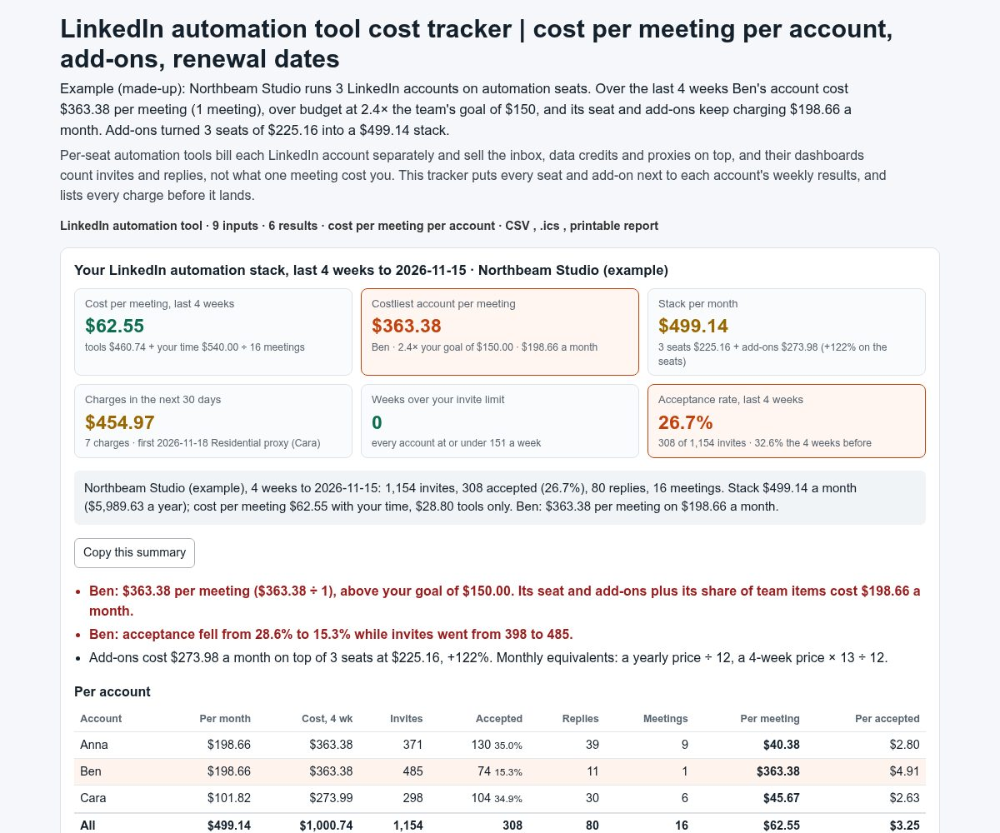

# LinkedIn automation tool cost tracker

[https://jmshinhwa.github.io/rulestamp-tools/linkedin-automation-tool-cost-tracker/](https://jmshinhwa.github.io/rulestamp-tools/linkedin-automation-tool-cost-tracker/)

## What it does

Each LinkedIn account's seat and add-ons as cost per meeting, and every charge due in the next 30 days. Type your stack (seats, inbox, data credits, proxies) and each account's weekly invites, accepts, replies and meetings; the page shows cost per meeting per account, the costliest account, add-ons on top of seats and the next charges.

## How to open

Open it in any browser: https://jmshinhwa.github.io/rulestamp-tools/linkedin-automation-tool-cost-tracker/ — nothing to install, your entries stay in your browser. Offline: download this folder and open `index.html`.

## Result after one filled case

## Rule source and date

- The rule is the arithmetic printed on the page: monthly equivalents = a yearly price ÷ 12, a 4-week price × 13 ÷ 12; cost per meeting = tools (+ your time if you enter it) ÷ meetings. Page checked 2026-11-15.

Save and continue: https://getreadystack.com/apps/linkedin-automation-tool-cost-tracker/
