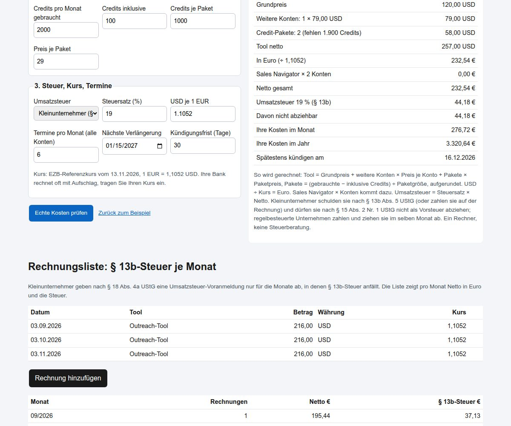

# LinkedIn Automatisierung Kostenrechner

[https://jmshinhwa.github.io/rulestamp-tools/linkedin-automatisierung-kostenrechner/](https://jmshinhwa.github.io/rulestamp-tools/linkedin-automatisierung-kostenrechner/)

## Was es macht

LinkedIn-Automatisierungstools rechnen in US-Dollar und ohne Steuer. Der Rechner zeigt die echten Kosten pro Konto und pro Termin in Euro: Zusatz-Konten, Credits, Sales Navigator, Wechselkurs und die § 13b-Umsatzsteuer, die Kleinunternehmer nicht abziehen dürfen.

## So öffnest du es

Im Browser öffnen: https://jmshinhwa.github.io/rulestamp-tools/linkedin-automatisierung-kostenrechner/ — nichts zu installieren, deine Eingaben bleiben in deinem Browser. Offline: diesen Ordner herunterladen und `index.html` öffnen.

## Ergebnis nach einem ausgefüllten Fall

## Regelquelle und Datum

- § 13b Abs. 5 UStG (Steuerschuld bei Rechnungen aus dem Ausland) · § 15 Abs. 2 Nr. 1 UStG (kein Vorsteuerabzug für Kleinunternehmer) · § 19 UStG (Kleinunternehmer) — https://www.gesetze-im-internet.de/ustg_1980/
- Toolpreise netto bei Monatszahlung, gelesen am 15.11.2026 auf den Preisseiten der Anbieter.

Speichern und weitermachen: https://getreadystack.com/de/apps/linkedin-automatisierung-kostenrechner/
