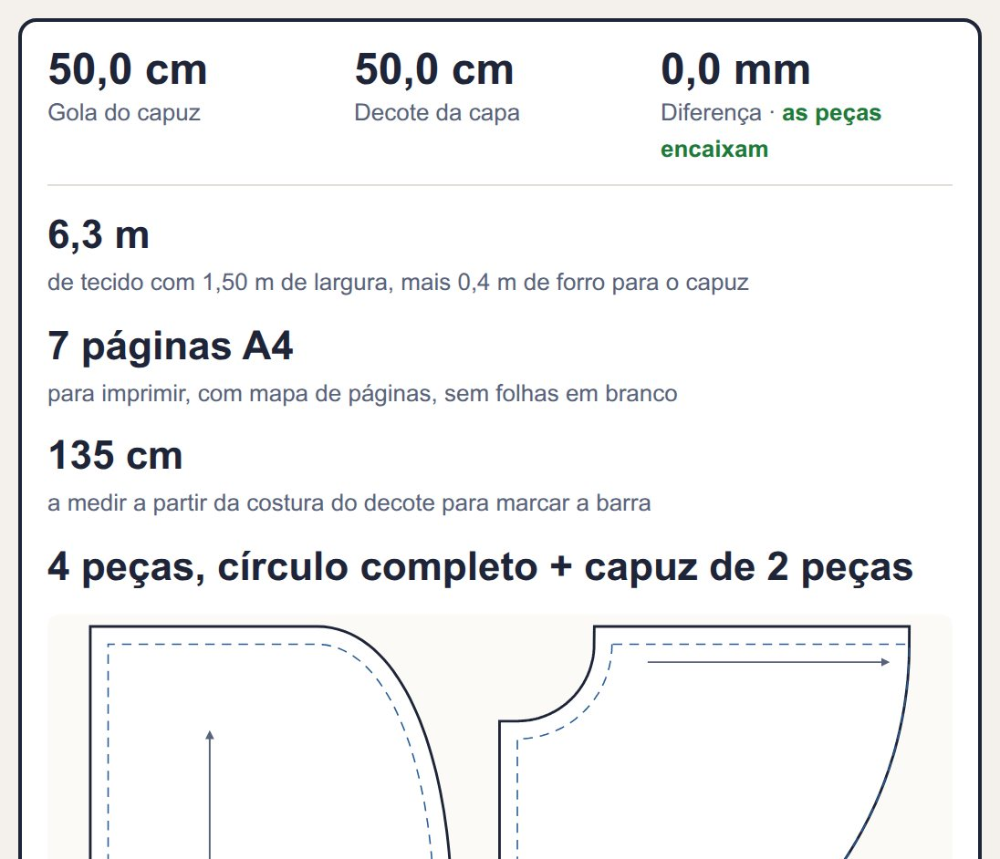

# Molde capa com capuz – molde PDF traçado por código (A4, A0, projetor)

[https://jmshinhwa.github.io/rulestamp-tools/molde-capa-com-capuz/](https://jmshinhwa.github.io/rulestamp-tools/molde-capa-com-capuz/)

## O que faz

Capa com capuz no seu pescoço: gola do capuz e decote medidos para encaixar Molde capa com capuz traçado por código a partir da medida do seu pescoço. Exemplo (inventado): tamanho M, círculo completo, até o chão, 135 cm. A gola do capuz mede 50,0 cm e o decote da capa 50,0 cm, 0,0 mm de diferença, antes de cortar 6,3 m de tecido com 1,50 m de largura. Para quem: costureiras, costureiros e cosplayers que fazem uma capa de inverno, medieval, de fantasia ou de fantasia de festa, no Brasil ou em Portugal. O que vem: 7 tamanhos (PP ao G2) ou a sua própria medida de pescoço e o seu comprimento. Capa de círculo completo ou meio círculo, capuz de 2 ou 3 peças. PDF A4 com mapa de páginas, nome do quadro em cada folha e quadrado de teste de 10 cm na página 1; nenhuma folha em branco. PDF A0 para a gráfica (plotter) e PDF para projetor, uma página por tamanho em escala 1:1. Instruções em português em 8 passos com desenhos feitos a partir das peças reais. Margem de costura de 1,5 cm incluída, barra de 2,5 cm. Grátis na página: o seu tamanho desenhado na tela, a conferência do decote, a lista de corte e o tecido que você precisa. Pago, uma vez só: os arquivos para imprimir. Sem fotos de uma peça costurada: as peças e as instruções são desenhos feitos por código. Arquivos digitais, nada é enviado pelo correio.

## Como abrir

Abra em qualquer navegador: https://jmshinhwa.github.io/rulestamp-tools/molde-capa-com-capuz/ — nada para instalar, seus dados ficam no seu navegador. Offline: baixe esta pasta e abra `index.html`.

## Resultado depois de preencher um caso

## Fonte da regra e data

- A regra é o cálculo impresso na página; página conferida em 2026-11-26.

Salvar e continuar: https://getreadystack.com/pt/apps/molde-capa-com-capuz/
