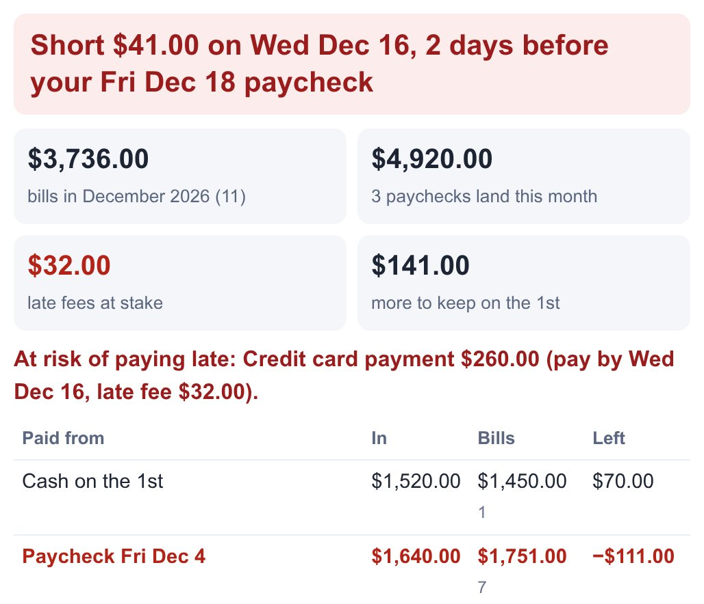

# monthly bill tracker

[https://jmshinhwa.github.io/rulestamp-tools/monthly-bill-tracker-paycheck-planner/](https://jmshinhwa.github.io/rulestamp-tools/monthly-bill-tracker-paycheck-planner/)

## What it does

monthly bill tracker: which paycheck pays each bill and the day you run short Made-up example: paid $1,640.00 every other Friday, 11 bills in December 2026. The month looks fine, but the Dec 4 paycheck has to carry $1,751.00 of bills, so on Wed Dec 16 the account is $41.00 short and the credit card payment due that day risks a $32.00 late fee. For: people paid every week, every two weeks or twice a month in the US who keep their bills in a list or a spreadsheet and still get surprised the week before payday. What it works out: each bill's safe pay-by day (weekends and the 11 Federal Reserve bank holidays moved to the business day before), which paycheck pays each bill, what is left from each paycheck, the first day the account would be short, the late fees at stake and how much more to keep on the 1st. Paydays on a holiday move too, so you see the months with a third biweekly paycheck and the Jan 1 paycheck that lands in December. Free on the page: one month, any number of bills, the whole answer on screen. No sign-up and no bank login: your data stays in your browser. A planning tool for your own numbers.

## How to open

Open it in any browser: https://jmshinhwa.github.io/rulestamp-tools/monthly-bill-tracker-paycheck-planner/ — nothing to install, your entries stay in your browser. Offline: download this folder and open `index.html`.

## Result after one filled case

## Rule source and date

- The rule is the calculation printed on the page; page checked 2026-11-18.

Save and continue: https://getreadystack.com/apps/monthly-bill-tracker-paycheck-planner/
