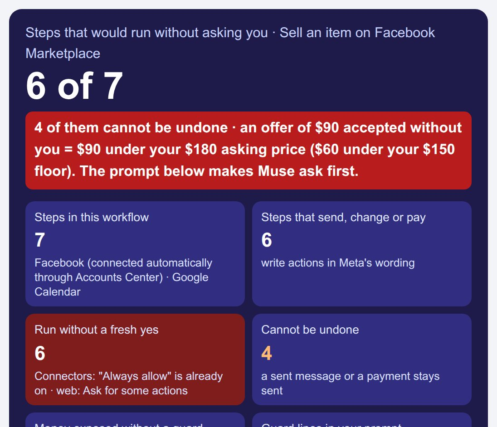

# Muse AI prompts

[https://jmshinhwa.github.io/rulestamp-tools/muse-ai-prompts/](https://jmshinhwa.github.io/rulestamp-tools/muse-ai-prompts/)

## What it does

Muse AI prompts that make Muse ask before it sends, pays or shares Example (made-up): Dana lets Muse sell her $180 oak desk on Facebook Marketplace with "Always allow" on; 6 of the 7 steps would run without asking her, 4 of them cannot be undone, and an offer of $90 accepted without her loses $90 of her asking price. For: people using Meta's Muse agent: selling on Facebook Marketplace, inbox and replies, booking meetings, shopping on a budget, trips, price watches and calling a provider about a bill. What it does: pick one of 7 tasks and say how your Muse permissions are set (Always ask, Ask for some actions, Allow for this task, Always allow). The page applies Meta's published permission rules to each step, counts the steps that would run without a fresh yes and the ones that cannot be undone, shows the money exposed without a guard, and writes a copy-paste prompt with stop-and-ask lines, your price or budget limit, a privacy-safe version and the exact Settings to change. Free: one workflow at a time, the whole answer on screen, any task. No sign-up; your inputs stay in your browser. Not affiliated with Meta. The step list per task is our own model of the task; we did not run these prompts inside Muse.

## How to open

Open it in any browser: https://jmshinhwa.github.io/rulestamp-tools/muse-ai-prompts/ — nothing to install, your entries stay in your browser. Offline: download this folder and open `index.html`.

## Result after one filled case

## Rule source and date

- The rule is the calculation printed on the page; page checked 2026-11-18.

Save and continue: https://getreadystack.com/apps/muse-ai-prompts/
