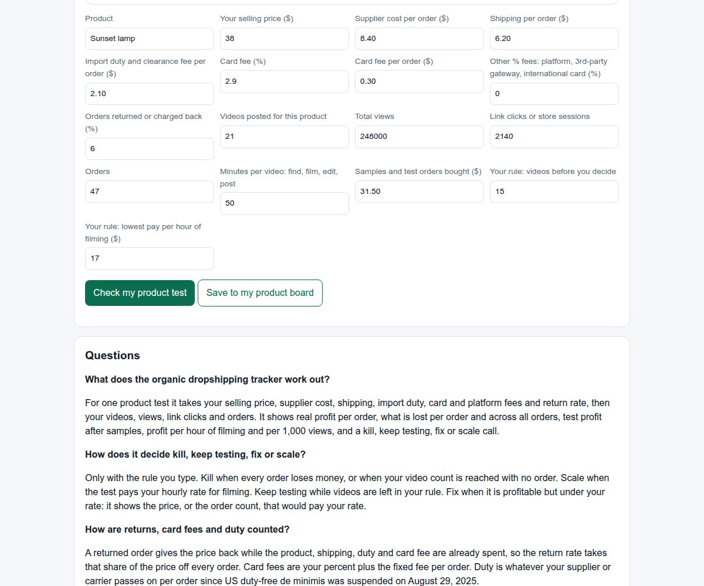

# organic dropshipping tracker

[https://jmshinhwa.github.io/rulestamp-tools/organic-dropshipping-tracker/](https://jmshinhwa.github.io/rulestamp-tools/organic-dropshipping-tracker/)

## What it does

Real profit per order and per video for one organic product test (no ad spend): shipping, import duty, card fee and returns come off the margin, then the page makes the call — kill, keep testing, fix or scale — by the rule you type.

## How to open

Open it in any browser: https://jmshinhwa.github.io/rulestamp-tools/organic-dropshipping-tracker/ — nothing to install, your entries stay in your browser. Offline: download this folder and open `index.html`.

## Result after one filled case

## Rule source and date

- Card fees: Shopify pricing — https://www.shopify.com/pricing
- Import duty: Executive Order 14324 (July 30, 2025) suspended duty-free de minimis treatment for all countries from August 29, 2025 — https://www.whitehouse.gov/presidential-actions/2025/07/suspending-duty-free-de-minimis-treatment-for-all-countries/
- Read on 2026-11-15.

Save and continue: https://getreadystack.com/apps/organic-dropshipping-tracker/
