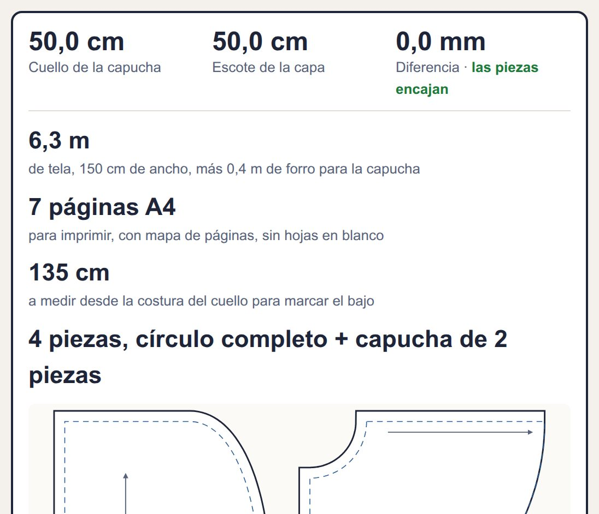

# Patrón capa con capucha – PDF A4, Carta y A0, tallas XS–3XL

[https://jmshinhwa.github.io/rulestamp-tools/patron-capa-con-capucha/](https://jmshinhwa.github.io/rulestamp-tools/patron-capa-con-capucha/)

## Qué hace

Capa con capucha a tu cuello: capucha y escote medidos para que encajen Patrón capa con capucha trazado por código desde tu contorno de cuello. Ejemplo (inventado): talla M, círculo completo, hasta el suelo, 135 cm. El cuello de la capucha mide 50,0 cm y el escote de la capa 50,0 cm, 0,0 mm de diferencia, antes de cortar 6,3 m de tela de 150 cm. Para quién: costureras y costureros de casa y cosplayers que hacen una capa de invierno, medieval, de fantasía o de disfraz, en España, México o donde sea. Qué incluye: 7 tallas (XS a 3XL) o tu propio cuello y largo. Capa de círculo completo o medio círculo, capucha de 2 o 3 piezas. PDF en A4 y en Carta (US Letter) con mapa de páginas, nombre de casilla en cada hoja y cuadrado de prueba en la página 1; sin hojas en blanco. PDF A0 para copistería y PDF para proyector, una página por talla a escala 1:1. Instrucciones en español en 8 pasos con dibujos hechos con las piezas reales. Margen de costura de 1,5 cm incluido, bajo 2,5 cm. Gratis en la página: tu talla dibujada en pantalla, la comprobación del escote, la lista de corte y la tela que necesitas. De pago, una vez: los archivos para imprimir. Sin fotos de una muestra cosida: las piezas y las instrucciones son dibujos hechos por código. Archivos digitales, no se envía nada.

## Cómo abrirlo

Ábrelo en cualquier navegador: https://jmshinhwa.github.io/rulestamp-tools/patron-capa-con-capucha/ — no hay nada que instalar, tus datos se quedan en tu navegador. Sin conexión: descarga esta carpeta y abre `index.html`.

## Resultado tras rellenar un caso

## Fuente de la regla y fecha

- La regla es el cálculo impreso en la página; página revisada el 2026-11-26.

Guardar y continuar: https://getreadystack.com/es/apps/patron-capa-con-capucha/
