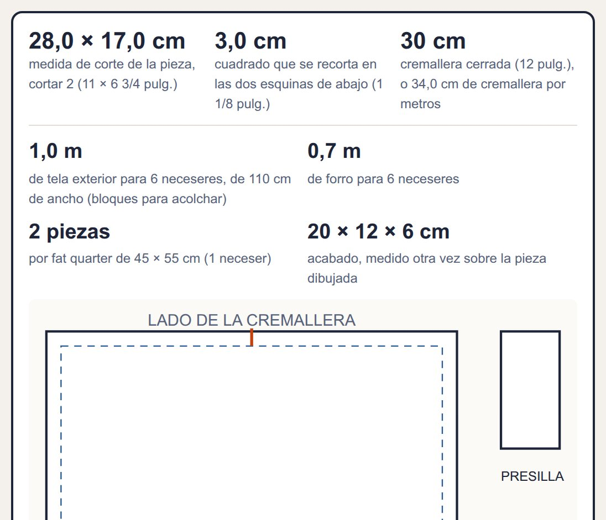

# Patrón neceser con cremallera – 4 tallas y tabla de corte

[https://jmshinhwa.github.io/rulestamp-tools/patron-neceser-con-cremallera/](https://jmshinhwa.github.io/rulestamp-tools/patron-neceser-con-cremallera/)

## Qué hace

Patrón neceser con cremallera: medidas de corte, cremallera y tela calculadas Patrón de neceser con cremallera trazado por código. Ejemplo (inventado): 6 neceseres M acolchados de 20 × 12 × 6 cm. La tabla dice que compres 1,0 m de tela exterior de 110 cm, no los 0,7 m que piden las piezas lisas, porque cada pieza se corta 2,5 cm más grande y se recorta después de acolchar. Si compras para las piezas lisas, te faltan 0,3 m: 4,20 € a un precio inventado de 14,00 € el metro. Para quién: quien cose neceseres y estuches para regalar o vender en mercadillos. Qué incluye: 4 tallas (S 12 × 8 × 4 cm a XL 30 × 18 × 10 cm), con fondo o planas, o tus propias medidas. Tabla de corte en cm (y pulgadas) para tela exterior, forro, bloque para acolchar, guata, guata termoadhesiva, presilla y cremallera (cerrada o por metros). La tela que comprar para todos los neceseres que vayas a coser y cuántas piezas salen de un fat quarter. PDF en A4 y Carta con cuadrado de prueba de 10 cm / 4 pulg., mapa de páginas y la tabla en la página 1. Un A0 para copistería con las 8 piezas, un archivo para proyector e instrucciones escritas en 8 pasos con dibujos. Margen de costura de 1 cm incluido. Gratis en la página: un neceser resuelto en pantalla. De pago, una sola vez: los archivos para imprimir. Sin fotos de un neceser cosido: las piezas y las instrucciones son dibujos hechos por código. Archivos digitales, no se envía nada por correo.

## Cómo abrirlo

Ábrelo en cualquier navegador: https://jmshinhwa.github.io/rulestamp-tools/patron-neceser-con-cremallera/ — no hay nada que instalar, tus datos se quedan en tu navegador. Sin conexión: descarga esta carpeta y abre `index.html`.

## Resultado tras rellenar un caso

## Fuente de la regla y fecha

- La regla es el cálculo impreso en la página; página revisada el 2026-11-26.

Guardar y continuar: https://getreadystack.com/es/apps/patron-neceser-con-cremallera/
