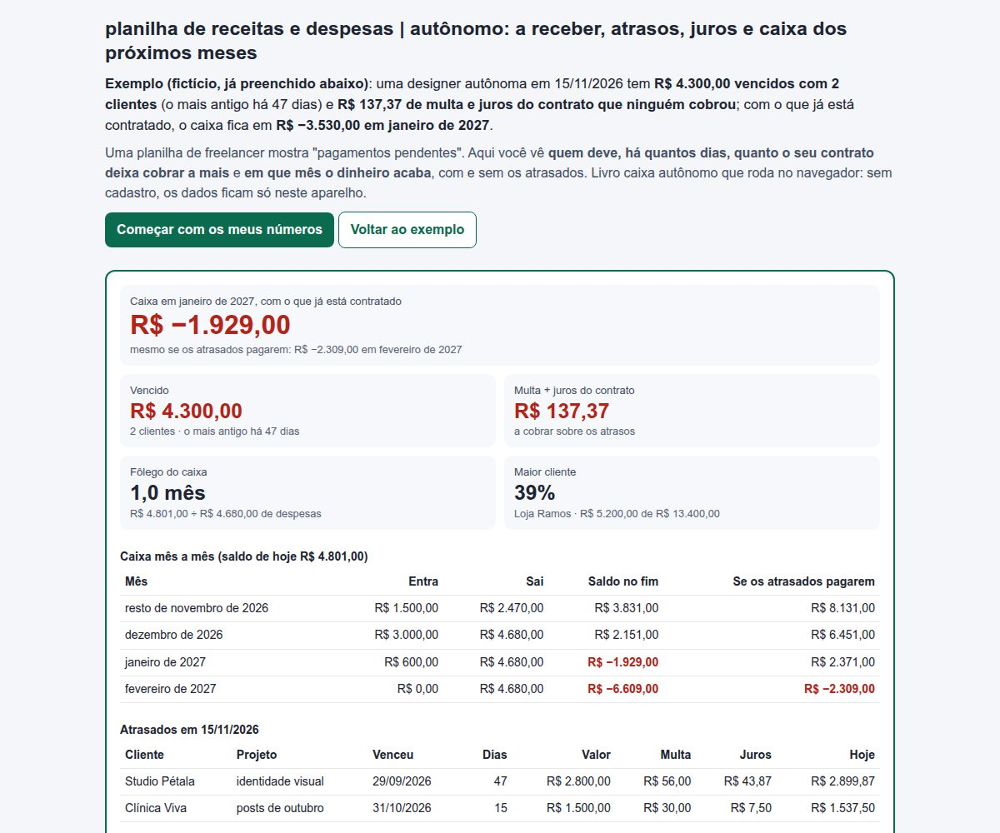

# planilha de receitas e despesas

[https://jmshinhwa.github.io/rulestamp-tools/planilha-de-receitas-e-despesas/](https://jmshinhwa.github.io/rulestamp-tools/planilha-de-receitas-e-despesas/)

## O que faz

Para autônomos: quem deve, há quantos dias, a multa e os juros do seu contrato que ninguém cobrou, e o caixa dos próximos meses com o que já está contratado.

## Como abrir

Abra em qualquer navegador: https://jmshinhwa.github.io/rulestamp-tools/planilha-de-receitas-e-despesas/ — nada para instalar, seus dados ficam no seu navegador. Offline: baixe esta pasta e abra `index.html`.

## Resultado depois de preencher um caso

## Fonte da regra e data

- A regra é a do seu contrato: multa e juros que você digita; juros contados por dia (% ao mês ÷ 30 × dias de atraso), como impresso na página. Página conferida em 15/11/2026.

Salvar e continuar: https://getreadystack.com/pt/apps/planilha-de-receitas-e-despesas/
