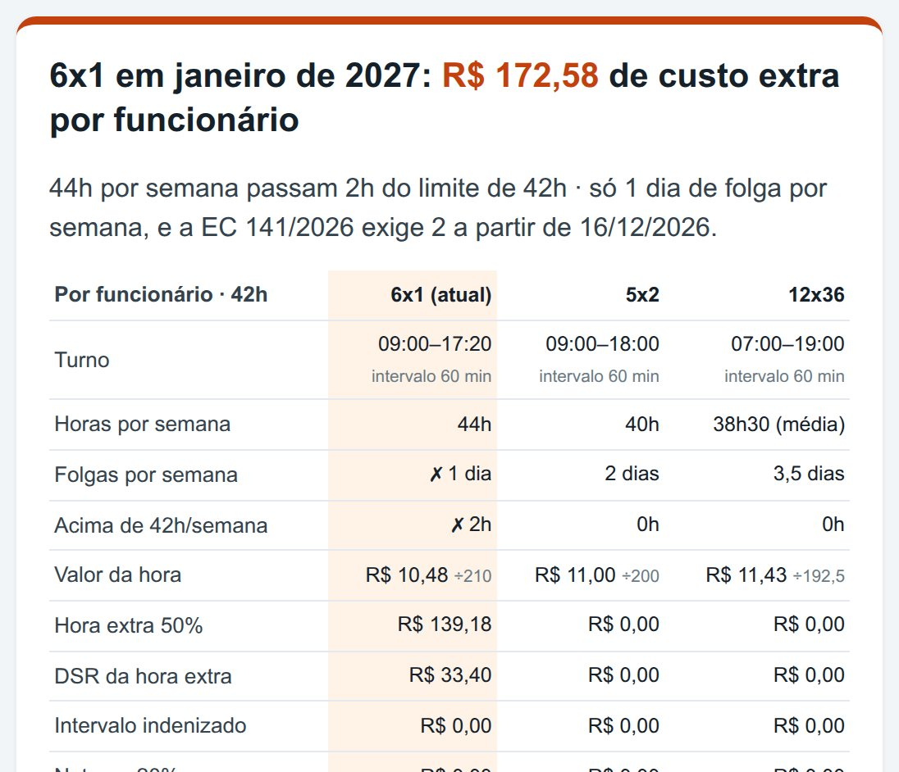

# planilha escala de trabalho: 6x1, 5x2, 12x36 · regra de 42h

[https://jmshinhwa.github.io/rulestamp-tools/planilha-escala-de-trabalho/](https://jmshinhwa.github.io/rulestamp-tools/planilha-escala-de-trabalho/)

## O que faz

planilha escala de trabalho: 6x1, 5x2 e 12x36 com hora extra e folgas de 2027 Exemplo (inventado): uma vendedora de R$ 2.200,00 na 6x1 das 09:00 às 17:20 trabalha 44h por semana. A partir de 16/12/2026 o limite é 42h e o repouso é de 2 dias (Emenda Constitucional 141/2026): mantida em janeiro de 2027, essa escala custa R$ 139,18 de hora extra + R$ 33,40 de DSR = R$ 172,58 por mês, e continua sem a 2ª folga. Para donos de loja, restaurante, clínica e gestores de RH/DP no Brasil que montam a escala de trabalho de equipes pequenas. Dentro: 3 escalas lado a lado (6x1, 5x2, 12x36) com o seu turno e o seu salário; 3 regras (até 15/12/2026 44h · a partir de 16/12/2026 42h e 2 folgas · a partir de 16/12/2027 40h); divisor 220/210/200 (Decreto 13.173/2026); hora extra de 50%, DSR, intervalo indenizado (CLT art. 71) e adicional noturno de 20% por mês; 6 checagens por escala (folgas, semana, dia, intervalo, 11h entre turnos, dias seguidos); o calendário do mês com domingos de folga e feriados nacionais. Grátis: a comparação e a escala do mês de um funcionário, completas na tela, sem cadastro. Os dados ficam no seu navegador. Ferramenta de cálculo, não é consultoria jurídica; a convenção coletiva da categoria pode ter regras próprias.

## Como abrir

Abra em qualquer navegador: https://jmshinhwa.github.io/rulestamp-tools/planilha-escala-de-trabalho/ — nada para instalar, seus dados ficam no seu navegador. Offline: baixe esta pasta e abra `index.html`.

## Resultado depois de preencher um caso

## Fonte da regra e data

- A regra é o cálculo impresso na página; página conferida em 2026-11-20.

Salvar e continuar: https://getreadystack.com/pt/apps/planilha-escala-de-trabalho/
