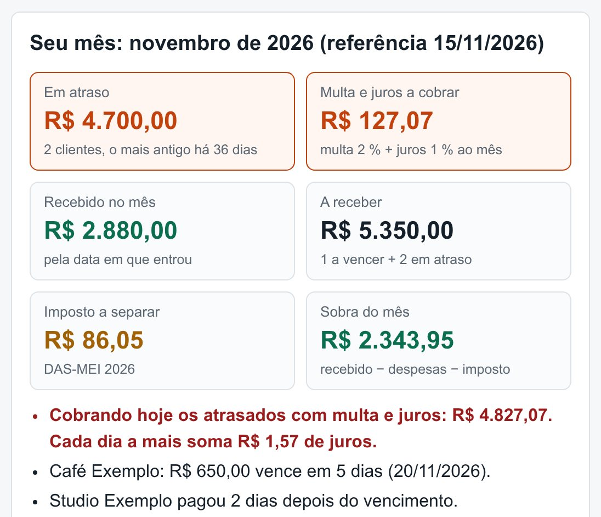

# planilha excel para autônomos

[https://jmshinhwa.github.io/rulestamp-tools/planilha-excel-para-autonomos/](https://jmshinhwa.github.io/rulestamp-tools/planilha-excel-para-autonomos/)

## O que faz

Atrasos com multa e juros do contrato, imposto e sobra do mês, e o .xlsx pronto Exemplo (fictício): uma designer MEI tem R$ 4.700,00 em atraso em 15/11/2026, um cliente há 36 dias e outro há 16. Com a multa de 2 % e os juros de 1 % ao mês do contrato, são R$ 127,07 a cobrar, que se perdem se ela mandar só o valor original. No mês entraram R$ 2.880,00; menos R$ 450,00 de despesas e R$ 86,05 de DAS, sobram R$ 2.343,95. Para autônomos, freelancers e MEI no Brasil que cobram clientes por mês ou por projeto: cole as cobranças (cliente; serviço; valor; vencimento; recebido em) e veja na hora o que está em atraso, quanto cobrar hoje com multa e juros pro rata, a mensagem de cobrança pronta, o imposto do seu regime (DAS-MEI 2026, Simples ou INSS + carnê-leão com a tabela 2026) e a sobra do mês. 6 inputs, 6 resultados: em atraso, multa e juros, recebido no mês, a receber, imposto a separar, sobra. Grátis: o mês inteiro na tela, com quantas cobranças quiser. Sem login: os dados ficam no seu navegador. Não é assessoria contábil ou jurídica.

## Como abrir

Abra em qualquer navegador: https://jmshinhwa.github.io/rulestamp-tools/planilha-excel-para-autonomos/ — nada para instalar, seus dados ficam no seu navegador. Offline: baixe esta pasta e abra `index.html`.

## Resultado depois de preencher um caso

## Fonte da regra e data

- A regra é o cálculo impresso na página; página conferida em 2026-11-15.

Salvar e continuar: https://getreadystack.com/pt/apps/planilha-excel-para-autonomos/
