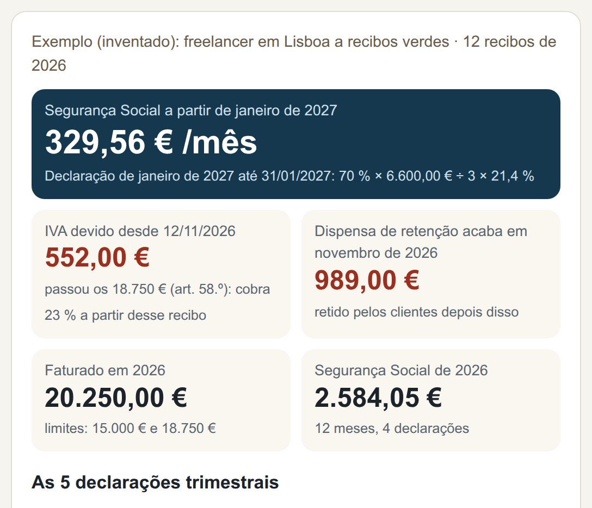

# planilha fiscal para autónomos

[https://jmshinhwa.github.io/rulestamp-tools/planilha-fiscal-autonomos-portugal/](https://jmshinhwa.github.io/rulestamp-tools/planilha-fiscal-autonomos-portugal/)

## O que faz

planilha fiscal para autónomos: Segurança Social, IVA art. 53.º e retenção Exemplo (inventado): uma freelancer em Lisboa a recibos verdes perde a isenção de IVA no recibo de 12/11/2026, quando passa os 18.750 €, e deve 552,00 € de IVA nesse recibo; a dispensa de retenção acabou em novembro (989,00 € retidos) e a declaração trimestral de janeiro de 2027 fixa 329,56 € por mês à Segurança Social. Os simuladores grátis fazem um trimestre de cada vez. Esta planilha guarda os recibos do ano e mostra as 5 declarações trimestrais, o mês em que passa os 15.000 € e os 18.750 € e quando acaba a dispensa de retenção. Para quem: trabalhadores independentes em Portugal a recibos verdes (serviços ou venda de bens). Grátis: o ano inteiro no ecrã, com todos os recibos que quiser: Segurança Social por declaração e por mês, limite de IVA recibo a recibo, retenção na fonte e a comparação com a contabilidade organizada. Sem registo: os dados ficam no seu navegador. Não é aconselhamento fiscal.

## Como abrir

Abra em qualquer navegador: https://jmshinhwa.github.io/rulestamp-tools/planilha-fiscal-autonomos-portugal/ — nada para instalar, seus dados ficam no seu navegador. Offline: baixe esta pasta e abra `index.html`.

## Resultado depois de preencher um caso

## Fonte da regra e data

- A regra é o cálculo impresso na página; página conferida em 2026-11-15.

Salvar e continuar: https://getreadystack.com/pt/apps/planilha-fiscal-autonomos-portugal/
