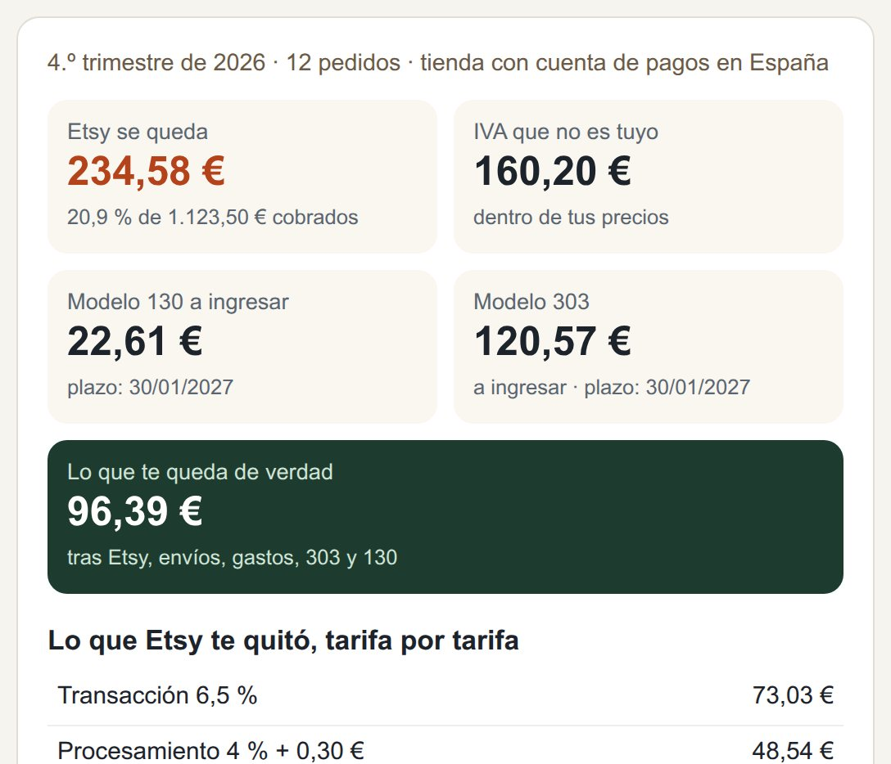

# plantilla contabilidad Excel

[https://jmshinhwa.github.io/rulestamp-tools/plantilla-contabilidad-excel-etsy/](https://jmshinhwa.github.io/rulestamp-tools/plantilla-contabilidad-excel-etsy/)

## Qué hace

plantilla contabilidad Excel: lo que se queda Etsy, tu IVA y tu modelo 130 Ejemplo (inventado): una ceramista que vende en Etsy desde España cobra 1.123,50 € en 12 pedidos del 4.º trimestre de 2026 y sufre una pérdida de 234,58 € (20,9 %) en comisiones de Etsy; 160,20 € son IVA de Hacienda y, tras envíos, compras, el 303 y el 130, le quedan 96,39 €. Una plantilla de Etsy hecha para EE. UU. cuenta el procesamiento al 3 % + 0,25 $. Esta usa las tarifas de una tienda con cuenta de pagos en España y saca el 130 y el 303 del trimestre. Para quién: autónomos que venden artículos físicos en Etsy desde España. Gratis: el trimestre entero en pantalla, con todos los pedidos y gastos que quieras: comisiones de Etsy por pedido, IVA de tus precios, margen por producto, casillas del 130, 303 y lo que te queda. Sin registro: los datos se quedan en tu navegador. No es asesoramiento fiscal; not tax advice.

## Cómo abrirlo

Ábrelo en cualquier navegador: https://jmshinhwa.github.io/rulestamp-tools/plantilla-contabilidad-excel-etsy/ — no hay nada que instalar, tus datos se quedan en tu navegador. Sin conexión: descarga esta carpeta y abre `index.html`.

## Resultado tras rellenar un caso

## Fuente de la regla y fecha

- La regla es el cálculo impreso en la página; página revisada el 2026-11-15.

Guardar y continuar: https://getreadystack.com/es/apps/plantilla-contabilidad-excel-etsy/
