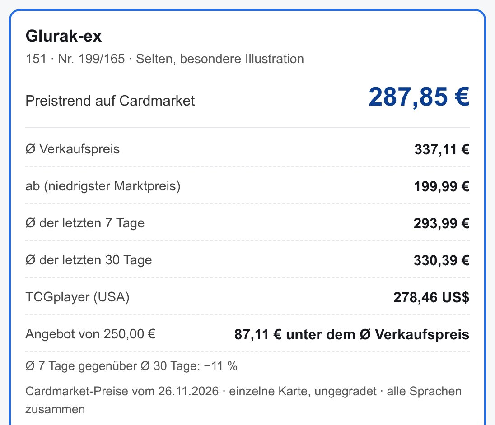

# Pokémon Karten Preise

[https://jmshinhwa.github.io/rulestamp-tools/pokemon-karten-preise/](https://jmshinhwa.github.io/rulestamp-tools/pokemon-karten-preise/)

## Was es macht

Gib deine Pokémon-Karte ein und sieh ihren Cardmarket-Preis in €, mit Datum Beispiel (erfunden): Jemand bietet dir 250 € für dein Glurak-ex 199/165 aus 151. Am 26.11.2026 lag der Ø Verkaufspreis dieser Karte auf Cardmarket bei 337,11 €: Nimmst du an, fehlen dir 87,11 €. Für Pokémon-Sammler in Deutschland, Österreich und der Schweiz, die auf Cardmarket, eBay oder Kleinanzeigen kaufen, verkaufen oder tauschen. Gib Name und Nummer ein, so wie sie auf deiner deutschen Karte stehen. Du siehst die Cardmarket-Preise in Euro mit Datum: Preistrend, Ø Verkaufspreis, ab-Preis, Ø 7 und 30 Tage und Reverse Holo, dazu TCGplayer in Dollar. 18.807 Karten mit Preis aus 138 Erweiterungen, vom Grundset (1999) bis Delta-Herrschaft (2026). Kostenlos auf dem Bildschirm: so viele Suchen, wie du willst, der Abstand zu einem Angebot und eine Liste für heute mit Summe. Vollversion: deine gespeicherte Sammlung mit Bezahlt und Wert, eine Kurve ihres Werts, Preisalarme mit deiner Grenze („unter 250 €“, „steigt um 20 %“) beim Öffnen der Seite oder als Browser-Benachrichtigung, CSV importieren und herunterladen. Preise für einzelne, ungegradete Karten; Cardmarket führt alle Sprachen einer Karte als ein Produkt. Keine Anlageberatung. Nicht verbunden mit Nintendo, The Pokémon Company oder Cardmarket.

## So öffnest du es

Im Browser öffnen: https://jmshinhwa.github.io/rulestamp-tools/pokemon-karten-preise/ — nichts zu installieren, deine Eingaben bleiben in deinem Browser. Offline: diesen Ordner herunterladen und `index.html` öffnen.

## Ergebnis nach einem ausgefüllten Fall

## Regelquelle und Datum

- Die Regel ist die auf der Seite gedruckte Rechnung; Seite geprüft am 2026-11-26.

Speichern und weitermachen: https://getreadystack.com/de/apps/pokemon-karten-preise/
