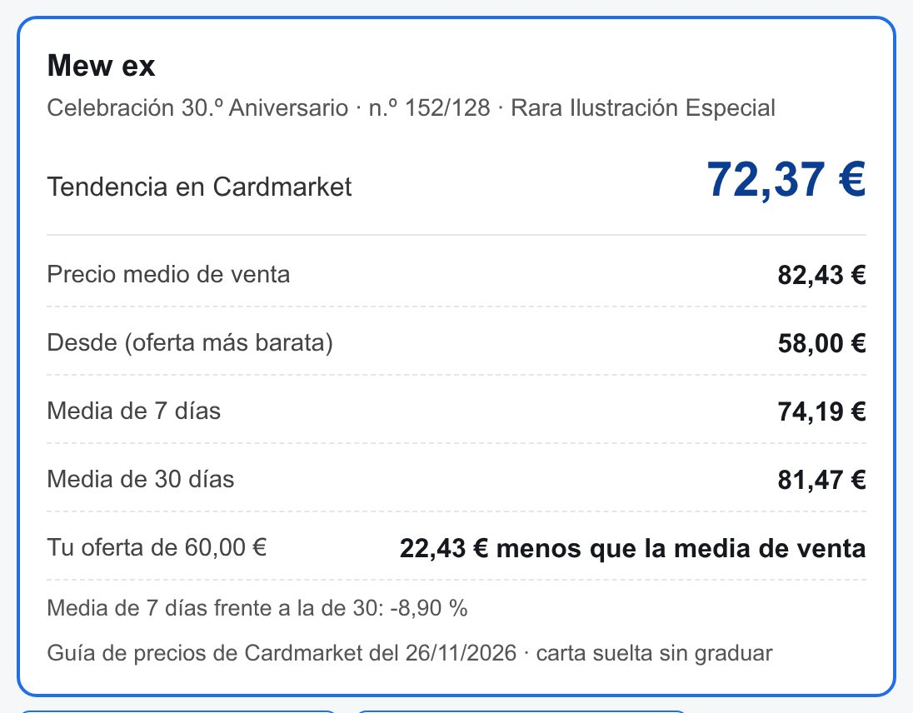

# Precio cartas Pokémon: Cardmarket en €, colección y avisos al abrir la página

[https://jmshinhwa.github.io/rulestamp-tools/precio-cartas-pokemon/](https://jmshinhwa.github.io/rulestamp-tools/precio-cartas-pokemon/)

## Qué hace

Escribe tu carta Pokémon y ve su precio de Cardmarket en €, con la fecha Ejemplo inventado: te ofrecen 60 € por tu Mew ex 152/128 (Celebración 30.º Aniversario). El 26/11/2026 esa carta se vendía en Cardmarket a una media de 82,43 €: aceptar era cobrar 22,43 € menos. Para coleccionistas de cartas Pokémon en España y en Europa que venden, cambian o compran por Cardmarket. Escribe el nombre y el número de tu carta, también en español. Ves la guía de Cardmarket en euros: tendencia, precio medio de venta, desde (la oferta más barata) y medias de 7 y 30 días, con la fecha, y el precio de TCGplayer en dólares. 14.392 cartas con precio en 106 expansiones en español, de Negro y Blanco (2011) a Dominio Delta (2026). Gratis en pantalla: todas las búsquedas que quieras, la diferencia con la oferta que te hacen y una lista del día con su total. Versión completa: tu colección guardada con lo que pagaste y lo que vale, una gráfica de su valor, avisos con tu línea («baja de 80 €», «sube un 20 %») al abrir la página o como notificación del navegador, e importar y descargar CSV. Precios de cartas sueltas sin graduar; no es asesoramiento financiero. No afiliado a Nintendo, The Pokémon Company ni Cardmarket.

## Cómo abrirlo

Ábrelo en cualquier navegador: https://jmshinhwa.github.io/rulestamp-tools/precio-cartas-pokemon/ — no hay nada que instalar, tus datos se quedan en tu navegador. Sin conexión: descarga esta carpeta y abre `index.html`.

## Resultado tras rellenar un caso

## Fuente de la regla y fecha

- La regla es el cálculo impreso en la página; página revisada el 2026-11-26.

Guardar y continuar: https://getreadystack.com/es/apps/precio-cartas-pokemon/
