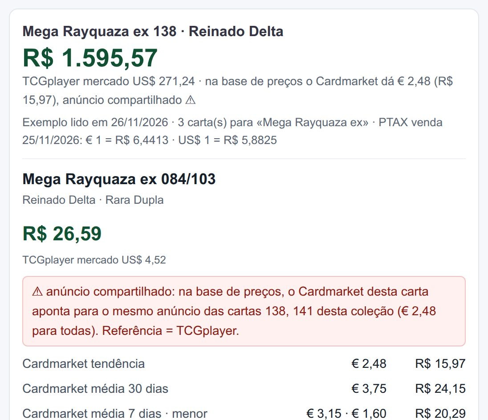

# preço cartas Pokémon: consulta em reais + lista com aviso por e-mail

[https://jmshinhwa.github.io/rulestamp-tools/preco-cartas-pokemon/](https://jmshinhwa.github.io/rulestamp-tools/preco-cartas-pokemon/)

## O que faz

preço cartas Pokémon em R$, € e US$, com aviso por e-mail na sua linha preço cartas Pokémon em reais, euro e dólar, carta por carta. Exemplo (lido em 26/11/2026): Mega Rayquaza ex 138, de Reinado Delta. A base pública de preços liga as três versões dessa carta (084, 138 e 141) ao mesmo anúncio do Cardmarket: € 2,48 para as três, ou R$ 15,97. No TCGplayer a 138 marca US$ 271,24, ou R$ 1.595,57. A diferença é de R$ 1.579,60. Para quem: colecionadores e quem vende ou troca cartas Pokémon no Brasil e quer saber quanto vale cada carta antes de anunciar. O que mostra: tendência, média de 7 e 30 dias e menor preço do Cardmarket em euro, mercado do TCGplayer em dólar e os dois em reais pela PTAX venda do Banco Central, com a data de cada preço. Nomes de cartas e coleções em português. Aviso ⚠ quando duas versões dividem o mesmo anúncio. Grátis: quantas cartas quiser, com o preço inteiro na tela, e uma lista desta visita com o total em reais. Preços da TCGdex (Cardmarket e TCGplayer). Só números lidos e convertidos; não dizemos o que comprar ou vender. Sem relação com Nintendo, The Pokémon Company, Cardmarket ou TCGplayer.

## Como abrir

Abra em qualquer navegador: https://jmshinhwa.github.io/rulestamp-tools/preco-cartas-pokemon/ — nada para instalar, seus dados ficam no seu navegador. Offline: baixe esta pasta e abra `index.html`.

## Resultado depois de preencher um caso

## Fonte da regra e data

- A regra é o cálculo impresso na página; página conferida em 2026-11-26.

Salvar e continuar: https://getreadystack.com/pt/apps/preco-cartas-pokemon/
