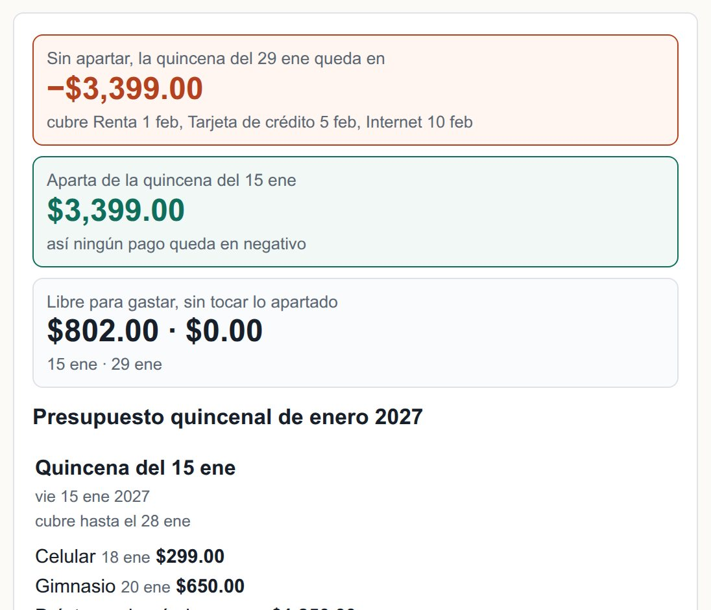

# presupuesto quincenal

[https://jmshinhwa.github.io/rulestamp-tools/presupuesto-quincenal-cuanto-apartar/](https://jmshinhwa.github.io/rulestamp-tools/presupuesto-quincenal-cuanto-apartar/)

## Qué hace

Qué pago fijo cubre cada quincena, cuál queda en negativo y cuánto apartar Ejemplo (inventado): con $10,500.00 netos por quincena en México, la quincena del 29 ene cubre la renta del 1 de febrero, la tarjeta del 5 y el internet del 10; sin apartar te faltan $3,399.00 y un pago queda pendiente. La página lo ve antes que tú: aparta $3,399.00 de la quincena del 15 ene y te quedan $802.00 libres. Un presupuesto mensual cuadra y aun así te quedas corto, porque la renta vence a principio de mes y la quincena llega a mitad. Aquí cada pago fijo cae en la quincena que de verdad lo paga, con el viernes antes si el 15 o el último día caen en fin de semana. Para quien cobra por quincena, catorcena o semana en México, Colombia y el resto de Latinoamérica. 11 inputs (moneda, mes, frecuencia, pago en fin de semana, fecha de un pago, sueldo neto por pago, saldo de hoy, gasto variable por pago, ahorro por pago, pagos fijos, ingresos extra). MXN, COP, USD y EUR. Gratis: un mes completo en pantalla, con todos los pagos fijos que quieras, lo que aparta cada quincena y lo libre. Sin cuenta ni conexión al banco: los datos se quedan en tu navegador. Herramienta de cálculo; no es asesoría.

## Cómo abrirlo

Ábrelo en cualquier navegador: https://jmshinhwa.github.io/rulestamp-tools/presupuesto-quincenal-cuanto-apartar/ — no hay nada que instalar, tus datos se quedan en tu navegador. Sin conexión: descarga esta carpeta y abre `index.html`.

## Resultado tras rellenar un caso

## Fuente de la regla y fecha

- La regla es el cálculo impreso en la página; página revisada el 2026-11-15.

Guardar y continuar: https://getreadystack.com/es/apps/presupuesto-quincenal-cuanto-apartar/
