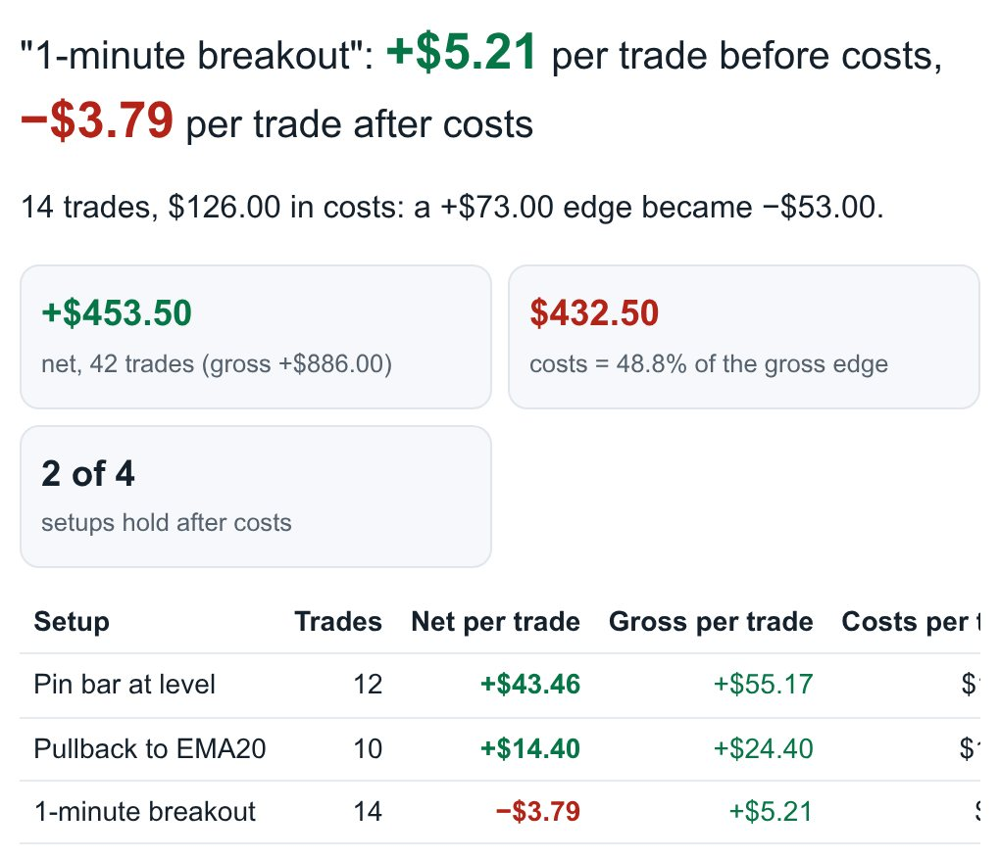

# Price action trading journal

[https://jmshinhwa.github.io/rulestamp-tools/price-action-trading-journal/](https://jmshinhwa.github.io/rulestamp-tools/price-action-trading-journal/)

## What it does

Price action trading journal: which setup holds after spread and commission Example (made-up): 42 trades in EURUSD, GBPUSD and gold. The "1-minute breakout" setup makes +$5.21 per trade before costs and −$3.79 per trade after spread and commission: 14 trades lost $53.00 although they had a +$73.00 edge before costs. For: price action traders on MT4, MT5, cTrader or Tradovate (forex, gold, indices, micro futures) who want to know which setup still holds after costs. What it computes, for every setup: gross expectancy per trade, costs per trade (spread, commission, swap, extra slippage), net expectancy per trade, net in R, win rate, break-even win rate after costs, cost buffer per lot and a 3-step verdict (holds after costs · costs eat the edge · loses before costs). Free on the page: paste one history (MT4/MT5 table, cTrader CSV, Tradovate Performance CSV or your own journal spreadsheet), any number of trades, every setup in full on screen. No sign-up, data stays in your browser. A tool to record and compute your own trades. It makes no calls on what to trade; every decision stays yours.

## How to open

Open it in any browser: https://jmshinhwa.github.io/rulestamp-tools/price-action-trading-journal/ — nothing to install, your entries stay in your browser. Offline: download this folder and open `index.html`.

## Result after one filled case

## Rule source and date

- The rule is the calculation printed on the page; page checked 2026-11-19.

Save and continue: https://getreadystack.com/apps/price-action-trading-journal/
