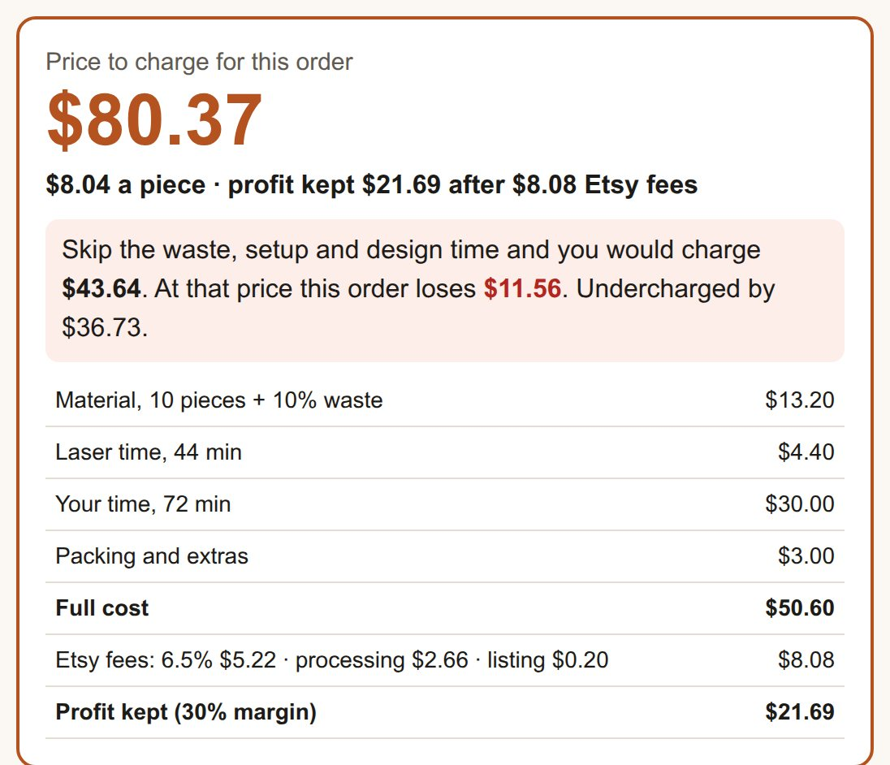

# pricing calculator for laser engraving — job cost & profit tracker

[https://jmshinhwa.github.io/rulestamp-tools/pricing-calculator-for-laser-engraving/](https://jmshinhwa.github.io/rulestamp-tools/pricing-calculator-for-laser-engraving/)

## What it does

pricing calculator for laser engraving that covers waste, setup and Etsy fees pricing calculator for laser engraving orders. Example (made-up): 10 engraved wooden ornaments sold as one Etsy item. Count the 10% waste and the 50 minutes of setup and design, and the price to charge is $80.37. Skip them and you would charge $43.64, and after Etsy's fees the order loses $11.56. Who it is for: laser engravers who sell personalised orders on Etsy or at craft fairs and price each job by hand. What it counts (12 inputs): pieces, blank cost, waste %, laser minutes, hands-on minutes, setup, design, packing, machine $/hour, your $/hour, margin and where it sells. On Etsy it solves the list price so that the 6.5% transaction fee, the 3% + $0.25 payment processing fee and the $0.20 listing fee (US rates, read 26 Nov 2026) are paid from the buyer's price, not your margin. Free: one order priced on screen in full, with the loss if you skip waste and setup. Any number of orders. CSV and backup too. Your data stays in your browser. Not affiliated with Etsy.

## How to open

Open it in any browser: https://jmshinhwa.github.io/rulestamp-tools/pricing-calculator-for-laser-engraving/ — nothing to install, your entries stay in your browser. Offline: download this folder and open `index.html`.

## Result after one filled case

## Rule source and date

- The rule is the calculation printed on the page; page checked 2026-11-26.

Save and continue: https://getreadystack.com/apps/pricing-calculator-for-laser-engraving/
