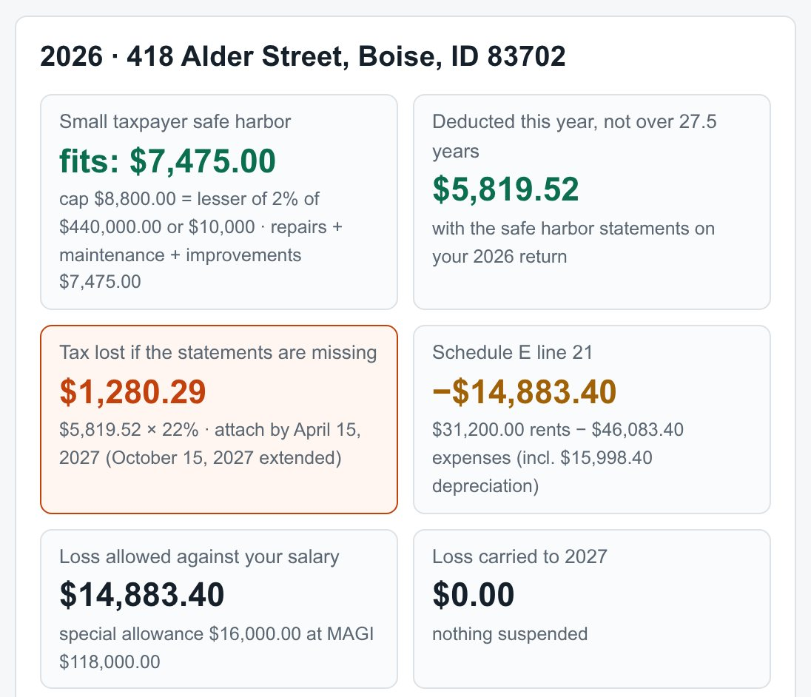

# rental property spreadsheet

[https://jmshinhwa.github.io/rulestamp-tools/rental-property-spreadsheet-tax-deductions/](https://jmshinhwa.github.io/rulestamp-tools/rental-property-spreadsheet-tax-deductions/)

## What it does

Which rental repairs you can deduct this year, and the tax lost without the election Example (made-up): a Boise landlord's $5,900.00 HVAC replacement in August 2026 fits under the $8,800.00 small taxpayer cap, so it can be deducted this year; without the safe harbor statement on the 2026 return only $80.48 is, and $1,280.29 of tax is lost at 22%. Repairs, maintenance and improvements on the $440,000 building come to $7,475.00. Rental bookkeeping apps file that HVAC under CapEx or fixed assets and depreciate it. This tracker gives every expense line its treatment: repair, routine maintenance, de minimis item, small taxpayer safe harbor or 27.5-year depreciation. For US landlords with a residential rental who do their own Schedule E: 13 inputs, 6 results (safe harbor fit, amount deducted this year instead of over 27.5 years, tax lost without the statements, Schedule E line 21, loss allowed under the $25,000 passive allowance, loss carried on). Schedule E lines 3-21 with and without the elections. Free: one rental and one year, any number of expense lines, everything on screen. Data stays in your browser. Rules from IRS Publications 527 and 925 and the tangible property regulations FAQ, read 2026-11-18. A calculation and record tool, not tax or legal advice.

## How to open

Open it in any browser: https://jmshinhwa.github.io/rulestamp-tools/rental-property-spreadsheet-tax-deductions/ — nothing to install, your entries stay in your browser. Offline: download this folder and open `index.html`.

## Result after one filled case

## Rule source and date

- The rule is the calculation printed on the page; page checked 2026-11-18.

Save and continue: https://getreadystack.com/apps/rental-property-spreadsheet-tax-deductions/
