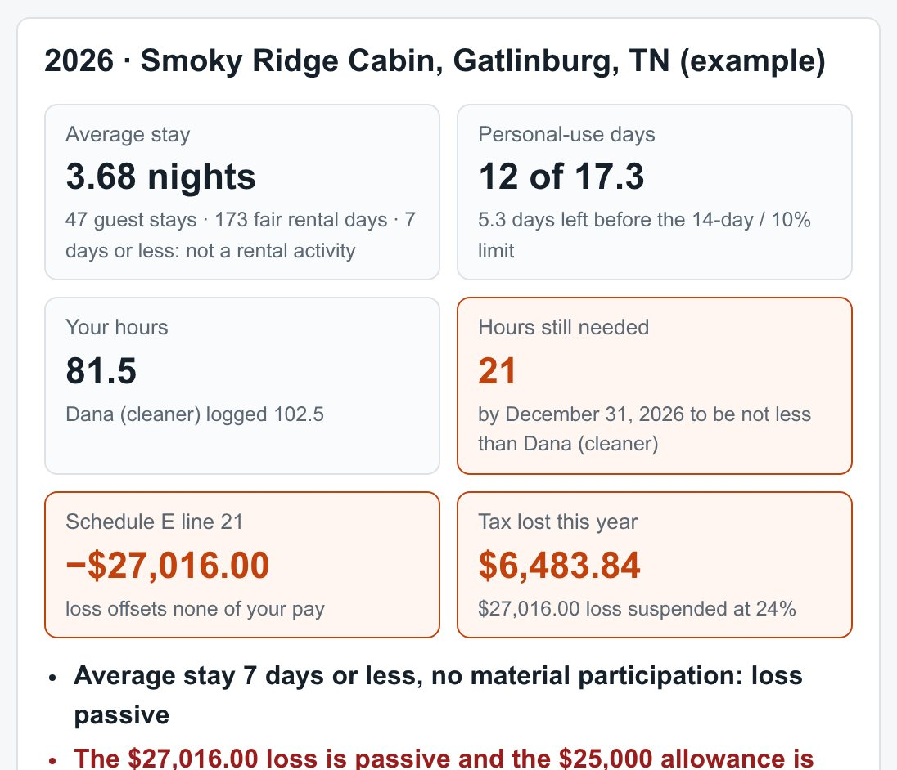

# rental tracker

[https://jmshinhwa.github.io/rulestamp-tools/rental-tracker-short-term-rental-hours/](https://jmshinhwa.github.io/rulestamp-tools/rental-tracker-short-term-rental-hours/)

## What it does

Short-term rental loss vs your pay: hours still needed and the tax lost Example (made-up): a Gatlinburg cabin host logged 81.5 hours by 2026-11-15 and the cleaner 102.5, so the $27,016.00 short-term rental loss can't offset their pay and $6,483.84 of tax is lost at 24%. 21 more logged hours by December 31 would keep it. Hour trackers count your hours and spreadsheets count your money. This rental tracker does both, plus the other two tests: the average stay from your bookings (7 days or less = not a rental activity), personal-use days against the 14-day / 10% limit, and your hours against each other person's (a cleaner is "any other individual"). For US short-term rental hosts (Airbnb, Vrbo, direct) who do their own Schedule E: 18 inputs, 6 results (average stay, personal days left, your hours, hours still needed, Schedule E line 21, tax lost this year), Schedule E line 2 days and lines 3-22, and Worksheet 5-1 when the place counts as your home. Free: one rental and one year, any number of stays and hour lines, everything on screen. Data stays in your browser. Rules from IRS Publications 527 and 925, the Schedule E instructions and Treas. Reg. 1.469-1 and 1.469-5T, read 2026-11-18. A calculation and record tool, not tax or legal advice.

## How to open

Open it in any browser: https://jmshinhwa.github.io/rulestamp-tools/rental-tracker-short-term-rental-hours/ — nothing to install, your entries stay in your browser. Offline: download this folder and open `index.html`.

## Result after one filled case

## Rule source and date

- The rule is the calculation printed on the page; page checked 2026-11-18.

Save and continue: https://getreadystack.com/apps/rental-tracker-short-term-rental-hours/
