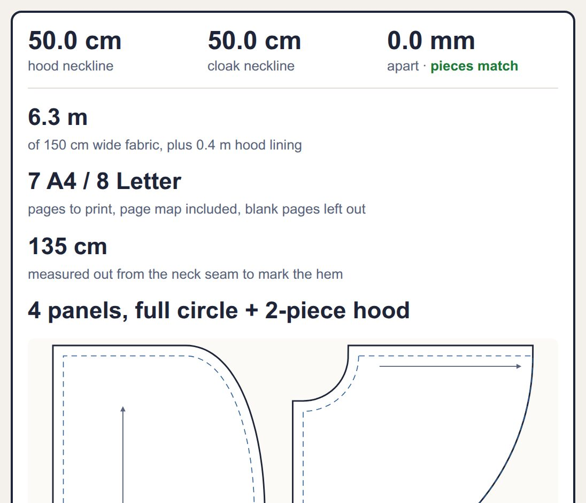

# Sewing pattern — hooded cloak PDF (A4/Letter + A0, XS–3XL)

[https://jmshinhwa.github.io/rulestamp-tools/sewing-pattern-hooded-cloak/](https://jmshinhwa.github.io/rulestamp-tools/sewing-pattern-hooded-cloak/)

## What it does

Hooded cloak pattern drafted to your neck: hood and neckline measured to match Hooded cloak sewing pattern drafted by code from your neck size. Example (made-up): size M, full circle, floor length 135 cm. The hood neckline measures 50.0 cm and the cloak neckline 50.0 cm, 0.0 mm apart, before you cut 6.3 m of 150 cm fabric. Who: home sewists and cosplayers making a fantasy, medieval or Halloween cloak. What is in it: 7 sizes (XS to 3XL) or your own neck size and length. Full or half circle cloak, 2-piece or 3-piece hood. A4 and US Letter PDFs with a page map, tile names on every page and a 10 cm / 4 in test square on page 1; blank pages are left out. A0 copy-shop PDF and projector PDF, one page per size at 1:1. An 8-step sewing guide with line drawings made from the real pieces. Seam allowance 1.5 cm included, 2.5 cm hem. Free on the page: your size drawn on screen, the neckline check, the cutting list and the fabric you need. Paid, once: the printable files. No photos of a sewn sample: the pieces and the guide are drawings made by code. Digital files, nothing is shipped.

## How to open

Open it in any browser: https://jmshinhwa.github.io/rulestamp-tools/sewing-pattern-hooded-cloak/ — nothing to install, your entries stay in your browser. Offline: download this folder and open `index.html`.

## Result after one filled case

## Rule source and date

- The rule is the calculation printed on the page; page checked 2026-11-26.

Save and continue: https://getreadystack.com/apps/sewing-pattern-hooded-cloak/
