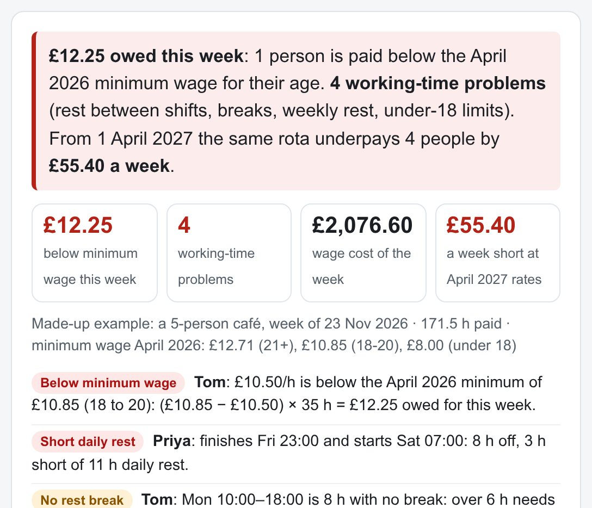

# shift planner

[https://jmshinhwa.github.io/rulestamp-tools/shift-planner-uk-rota-wage-cost/](https://jmshinhwa.github.io/rulestamp-tools/shift-planner-uk-rota-wage-cost/)

## What it does

shift planner: see who is paid below minimum wage and each person's wage cost Made-up example: a 5-person café rota with 171.5 paid hours and £2,076.60 of wages this week. Tom is 19 and paid £10.50 an hour, below the £10.85 minimum for 18 to 20, so £12.25 is owed for this one week, and Priya closes Friday at 23:00 and opens Saturday at 07:00: 8 h off where the law says 11 h. Paste your weekly rota from Excel or Google Sheets (or type it: 9-17, 10-14/18-22, 22-6, off) and see each person's paid hours, pay and wage cost, and every problem with the UK rule behind it. For: owners and managers of UK cafés, shops, takeaways, salons and care teams who plan the rota by hand. What it checks (6): minimum wage by age band on the week's date (£12.71 / £10.85 / £8.00 from April 2026, and the April 2027 rates), 11 h daily rest, 20-minute breaks over 6 h, 24 h weekly rest, the 48-hour week, and under-18 limits. Plus people on the rota against what you need each day, and optional holiday pay % and employer NI. Free: the full check of one week on screen, any number of staff. No sign-up; your rota stays in your browser. Rates read on GOV.UK on 20 Nov 2026. A calculation tool, not legal or payroll advice.

## How to open

Open it in any browser: https://jmshinhwa.github.io/rulestamp-tools/shift-planner-uk-rota-wage-cost/ — nothing to install, your entries stay in your browser. Offline: download this folder and open `index.html`.

## Result after one filled case

## Rule source and date

- The rule is the calculation printed on the page; page checked 2026-11-20.

Save and continue: https://getreadystack.com/apps/shift-planner-uk-rota-wage-cost/
