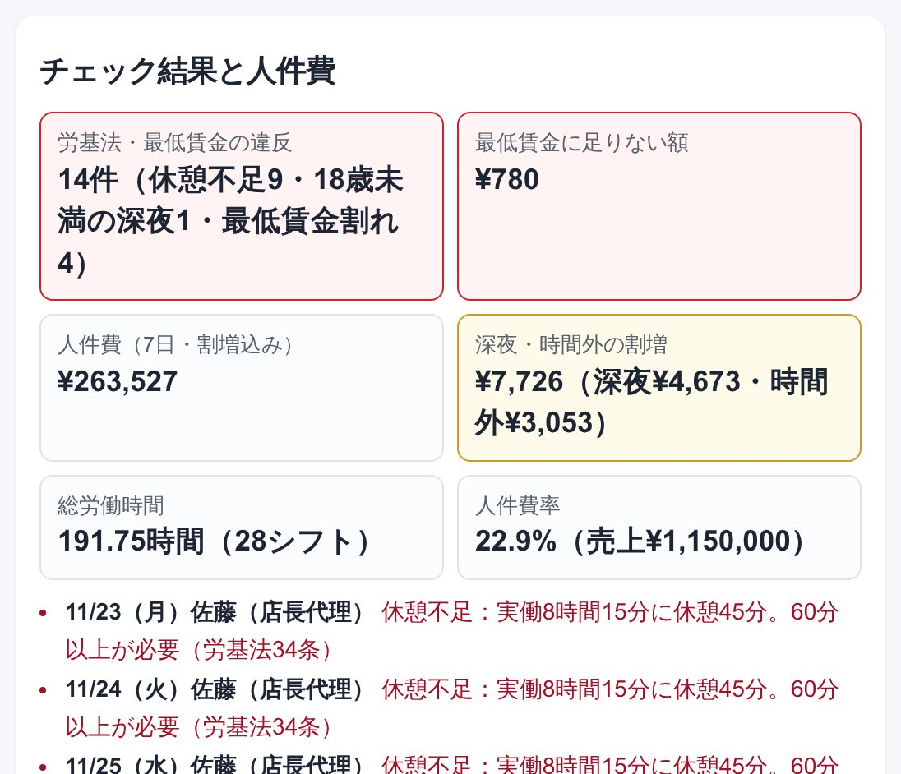

# シフト作成

[https://jmshinhwa.github.io/rulestamp-tools/shift-sakusei-roukihou-jinkenhi/](https://jmshinhwa.github.io/rulestamp-tools/shift-sakusei-roukihou-jinkenhi/)

## できること

シフト作成と同時に休憩不足・18歳未満の深夜・最低賃金割れを赤で示し、割増込みの人件費を出す 記入例（架空）：東京都のカフェ、スタッフ6人の1週間（2026-11-22〜28）。「9-18 休憩45分」は実働8時間15分なので休憩が15分足りず、時給1,250円のままのスタッフは10月1日からの東京都の最低賃金1,280円に1週間で¥780足りません。時給×時間だけのシフト表 テンプレートには出ない深夜・時間外の割増は¥7,726、見つかった違反は14件でした。 誰のため：アルバイト・パートのシフトを組む飲食店・小売店の店長やオーナー（3〜15人規模）。シフト作成 アプリにスタッフ全員を登録しなくても、ブラウザだけで使えます。 入っているもの：7 checks（休憩・深夜割増・時間外・18歳未満の深夜・18歳未満の時間外・最低賃金・週1日の休日）を1シフトずつ実行。6 inputs（名前・時給・年齢・始業・終業・休憩）から 6 results（違反の件数・最低賃金に足りない額・割増込みの人件費・深夜と時間外の割増・総労働時間・人件費率）を出します。47都道府県の令和8年度の最低賃金を発効日で切り替え（12月に変わる岩手・熊本・沖縄も日ごとに比べます）。 無料：シフト表1枚（1週間でも1か月でも・何人でも）のチェックと人件費、スタッフに送るLINE用の画像。 労基法34条・37条・60条・61条と最低賃金法（厚生労働省 令和8年度一覧・2026-11-20確認）に沿った計算の道具です。法律の判断は社会保険労務士や労働基準監督署に確認してください。入れた名前や時給はブラウザの外へ送りません。

## 開き方

ブラウザで開く: https://jmshinhwa.github.io/rulestamp-tools/shift-sakusei-roukihou-jinkenhi/ — インストール不要、入力はブラウザ内に残ります。オフライン: このフォルダをダウンロードして `index.html` を開く。

## 1件入力した結果

## ルールの出典と日付

- ルールはページに表示された計算式です（2026-11-20 確認）。

保存して続ける: https://getreadystack.com/ja/apps/shift-sakusei-roukihou-jinkenhi/
