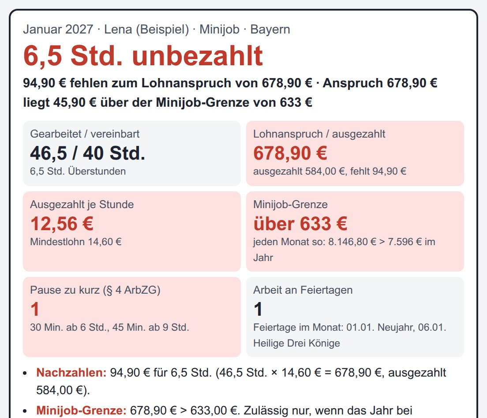

# Stundenzettel Vorlage 2027 — Excel mit Mindestlohn 14,60 € und Minijob-Prüfung

[https://jmshinhwa.github.io/rulestamp-tools/stundenzettel-vorlage-2027-excel/](https://jmshinhwa.github.io/rulestamp-tools/stundenzettel-vorlage-2027-excel/)

## Was es macht

Stundenzettel 2027: unbezahlte Stunden, Mindestlohn 14,60 € und Minijob 633 € Beispiel (erfunden): Lena hat einen Minijob in Bayern, 14,60 € pro Stunde, 40 Stunden im Monat vereinbart. Im Januar 2027 arbeitet sie 46,5 Stunden, ausgezahlt werden 584,00 €. 6,5 Stunden bleiben unbezahlt: 94,90 € fehlen. Und ihr Lohnanspruch von 678,90 € liegt 45,90 € über der Minijob-Grenze von 633 €. Für: Arbeitgeber mit Minijobbern und Aushilfen in Deutschland, und für Minijobber, die ihre Stunden selbst aufschreiben. Gratis: ein Monat komplett auf dem Bildschirm. Sie tragen Beginn, Ende und Pause je Tag ein und sehen sofort 6 Prüfungen: unbezahlte Stunden in Euro, Mindestlohn 14,60 € ab 01.01.2027, Minijob-Grenze 633 € im Monat, Pausen nach § 4 ArbZG, höchstens 10 Stunden am Tag und Arbeit an Feiertagen Ihres Bundeslands. Dazu für jeden Tag die Frist zum Aufschreiben nach § 17 MiLoG. Dazu der Stundenzettel zum Unterschreiben als PDF, alle Monate gespeichert, CSV und Backup. Ohne Anmeldung, die Daten bleiben im Browser. Keine Lohnabrechnung, keine Stempeluhr. Recording tool only, not legal advice.

## So öffnest du es

Im Browser öffnen: https://jmshinhwa.github.io/rulestamp-tools/stundenzettel-vorlage-2027-excel/ — nichts zu installieren, deine Eingaben bleiben in deinem Browser. Offline: diesen Ordner herunterladen und `index.html` öffnen.

## Ergebnis nach einem ausgefüllten Fall

## Regelquelle und Datum

- Die Regel ist die auf der Seite gedruckte Rechnung; Seite geprüft am 2026-11-26.

Speichern und weitermachen: https://getreadystack.com/de/apps/stundenzettel-vorlage-2027-excel/
