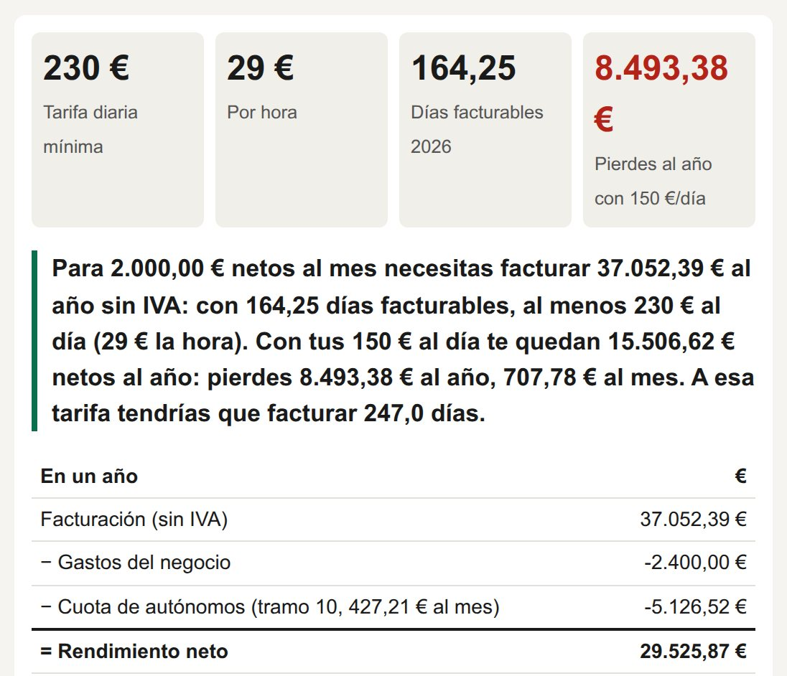

# tarifas freelance

[https://jmshinhwa.github.io/rulestamp-tools/tarifas-freelance/](https://jmshinhwa.github.io/rulestamp-tools/tarifas-freelance/)

## Qué hace

Tu tarifa diaria mínima de autónomo con festivos de tu comunidad, cuota e IRPF 2026 Ejemplo (inventado): diseñadora autónoma en Madrid que quiere 2.000 € netos al mes con 200 € de gastos. En 2026 le quedan 164,25 días facturables (10 festivos de Madrid en día laborable, 2 locales, 22 de vacaciones, 8 de baja o trámites y un 25 % sin facturar). Su tarifa diaria mínima es 230 € (29 € la hora). Cobrando 150 € al día lleva 8.493,38 € netos perdidos al año. tarifas freelance cuenta los festivos 2026 de tu comunidad tal como los publica el BOE, busca la facturación con la que la cuota de autónomos 2026 (15 tramos, sube con tu propia tarifa) y el IRPF te dejan el neto que pides, y te avisa de cuánto debe subir tu tarifa el mes en que se acaba la tarifa plana. Funciona en el navegador, sin cuenta. Para quién: autónomos y freelance en España (diseño, desarrollo, traducción, consultoría, marketing) que fijan o revisan su tarifa por día o por hora. Qué incluye: 19 calendarios de festivos 2026 (17 comunidades, Ceuta y Melilla), 15 tramos de cuota 2026, escala de IRPF con el 5 % de gastos de difícil justificación, aviso de fin de tarifa plana, retención 15 %/7 % frente a tu IRPF real, lo que paga tu cliente con IVA y retención. Gratis: un cálculo completo en pantalla, todas las veces que quieras. Una calculadora, no asesoramiento fiscal.

## Cómo abrirlo

Ábrelo en cualquier navegador: https://jmshinhwa.github.io/rulestamp-tools/tarifas-freelance/ — no hay nada que instalar, tus datos se quedan en tu navegador. Sin conexión: descarga esta carpeta y abre `index.html`.

## Resultado tras rellenar un caso

## Fuente de la regla y fecha

- La regla es el cálculo impreso en la página; página revisada el 2026-11-15.

Guardar y continuar: https://getreadystack.com/es/apps/tarifas-freelance/
