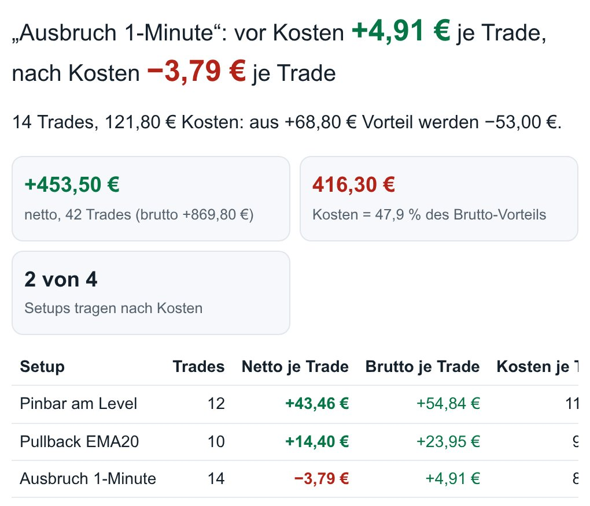

# Trading Journal

[https://jmshinhwa.github.io/rulestamp-tools/trading-journal-erwartungswert-setup/](https://jmshinhwa.github.io/rulestamp-tools/trading-journal-erwartungswert-setup/)

## Was es macht

Trading Journal: welches Setup nach Spread, Kommission und Swap noch trägt Beispiel (erfunden): 42 Trades in EURUSD, GBPUSD und Gold. Das Setup „Ausbruch 1-Minute“ bringt vor Kosten +4,91 € je Trade, nach Spread und Kommission −3,79 € je Trade: in 14 Trades sind 53,00 € verloren, obwohl vor Kosten +68,80 € Vorteil da waren. Für: Price-Action-Trader in Deutschland, Österreich und der Schweiz, die Forex, Gold oder Indizes über MT4, MT5 oder cTrader handeln und wissen wollen, welches Setup nach Kosten wirklich trägt. Was es rechnet, für jedes Setup: Erwartung brutto je Trade, Kosten je Trade (Spread, Kommission, Swap, Zusatz-Slippage), Erwartung netto je Trade, in R, Trefferquote, Break-even-Trefferquote nach Kosten, Kostenpuffer je Lot und ein Urteil in 3 Stufen (trägt nach Kosten · Kosten fressen den Vorteil · verliert schon vor Kosten). Kostenlos auf der Seite: eine Historie einfügen (MT4-/MT5-Tabelle, cTrader-CSV oder deine Trading Journal Vorlage), beliebig viele Trades, alle Setups vollständig auf dem Bildschirm. Ohne Anmeldung, die Daten bleiben im Browser. Ein Werkzeug zum Aufzeichnen und Rechnen: keine Signale, keine Anlageberatung.

## So öffnest du es

Im Browser öffnen: https://jmshinhwa.github.io/rulestamp-tools/trading-journal-erwartungswert-setup/ — nichts zu installieren, deine Eingaben bleiben in deinem Browser. Offline: diesen Ordner herunterladen und `index.html` öffnen.

## Ergebnis nach einem ausgefüllten Fall

## Regelquelle und Datum

- Die Regel ist die auf der Seite gedruckte Rechnung; Seite geprüft am 2026-11-18.

Speichern und weitermachen: https://getreadystack.com/de/apps/trading-journal-erwartungswert-setup/
