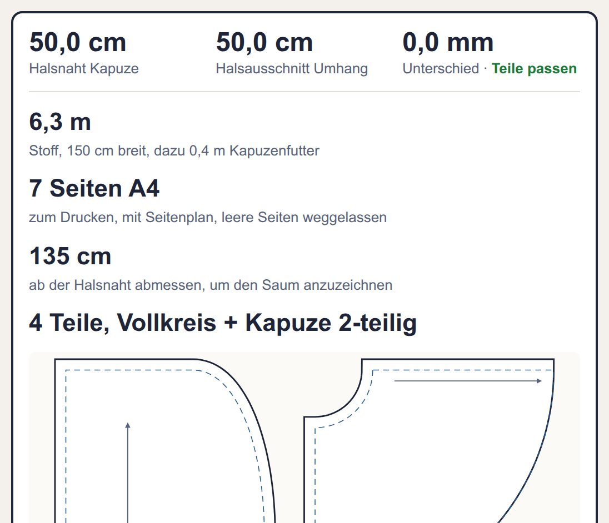

# Umhang Kapuze Schnittmuster – PDF, A4 + A0 Copyshop, XS–3XL

[https://jmshinhwa.github.io/rulestamp-tools/umhang-kapuze-schnittmuster/](https://jmshinhwa.github.io/rulestamp-tools/umhang-kapuze-schnittmuster/)

## Was es macht

Umhang mit Kapuze nach deinem Halsumfang: Kapuze und Ausschnitt gemessen Umhang Kapuze Schnittmuster, vom Code aus deinem Halsumfang konstruiert. Beispiel (ausgedacht): Größe M, Vollkreis, bodenlang 135 cm. Die Halsnaht der Kapuze misst 50,0 cm, der Halsausschnitt des Umhangs 50,0 cm, 0,0 mm Unterschied, bevor du 6,3 m Stoff (150 cm breit) zuschneidest. Für wen: Hobbyschneider und Cosplayer, die einen Winter-, Mittelalter- oder LARP-Umhang nähen. Was drin ist: 7 Größen (XS bis 3XL) oder dein eigener Halsumfang und deine Länge. Vollkreis oder Halbkreis, Kapuze 2- oder 3-teilig. A4-PDFs mit Seitenplan, Feldnamen auf jeder Seite und 10-cm-Testquadrat auf Seite 1; leere Seiten sind weggelassen. A0-PDF für den Copyshop und Beamer-PDF, eine Seite pro Größe im Maßstab 1:1. Nähanleitung auf Deutsch in 8 Schritten mit Strichzeichnungen aus den echten Teilen. Nahtzugabe 1,5 cm enthalten, Saum 2,5 cm. Kostenlos auf der Seite: deine Größe am Bildschirm gezeichnet, die Prüfung Kapuze gegen Ausschnitt, der Zuschnitt und der Stoffbedarf. Bezahlt, einmal: die Dateien zum Drucken. Keine Fotos eines genähten Musters: Teile und Anleitung sind Zeichnungen aus dem Code. Digitale Dateien, es wird nichts verschickt.

## So öffnest du es

Im Browser öffnen: https://jmshinhwa.github.io/rulestamp-tools/umhang-kapuze-schnittmuster/ — nichts zu installieren, deine Eingaben bleiben in deinem Browser. Offline: diesen Ordner herunterladen und `index.html` öffnen.

## Ergebnis nach einem ausgefüllten Fall

## Regelquelle und Datum

- Die Regel ist die auf der Seite gedruckte Rechnung; Seite geprüft am 2026-11-26.

Speichern und weitermachen: https://getreadystack.com/de/apps/umhang-kapuze-schnittmuster/
