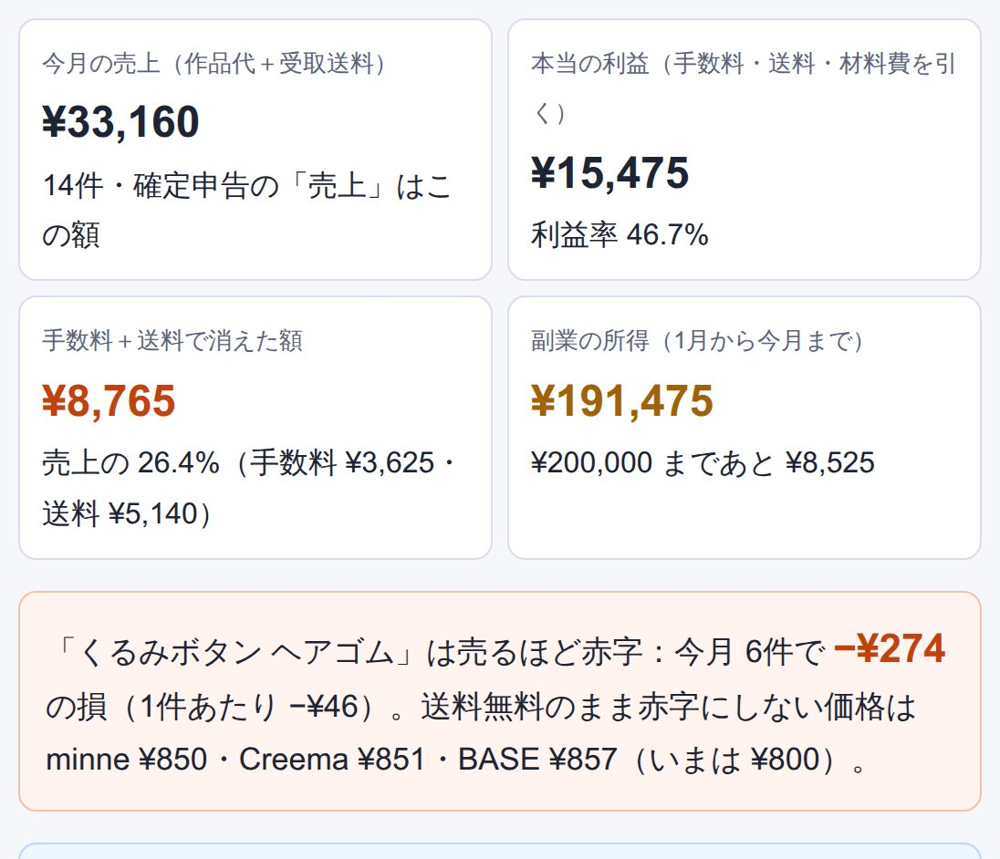

# 売上管理 表

[https://jmshinhwa.github.io/rulestamp-tools/uriage-kanri-hyo-handmade/](https://jmshinhwa.github.io/rulestamp-tools/uriage-kanri-hyo-handmade/)

## できること

売上管理 表：販売先の手数料と送料を引いた作品別の利益・赤字作品・20万円ラインが出る 記入例（架空のアクセサリー作家・会社員の副業・2026年11月）：minne・Creema・Etsy・BASE で14件、売上 ¥33,160。手数料と送料で ¥8,765（26.4%）が消え、本当の利益は ¥15,475。送料無料の「くるみボタン ヘアゴム」¥800 は1件あたり −¥46、今月6件で ¥274 の損です。副業の所得は ¥200,000 まであと ¥8,525。 Excel の売上管理表でよく聞く不満は「入力ミス」「販売先ごとにファイルが分かれる」こと。ここでは1行ずつ貼るだけで、販売先ごとの手数料（minne 10.56%・Creema 10.67% は送料込みに・Etsy・BASE）を自動で引きます。 対象：minne・Creema・Etsy・BASE・イベントで作品を売る日本のハンドメイド作家（会社員の副業も）。 中身（5つ）：(1) 1件1行の売上管理表（手数料・送料・材料費・利益） (2) 販売先ごとの売上・手数料・利益率 (3) 作品ごとの1件あたり利益と売るほど赤字の作品 (4) 送料無料のまま赤字にしない販売先別の価格 (5) 副業の所得¥200,000ラインまでの残りと確定申告の期限。 無料：今月分の答えを行数の上限なく画面に最後まで。 売上と経費を整理して計算する道具です。税務の判断はご自身か税理士にご確認ください。

## 開き方

ブラウザで開く: https://jmshinhwa.github.io/rulestamp-tools/uriage-kanri-hyo-handmade/ — インストール不要、入力はブラウザ内に残ります。オフライン: このフォルダをダウンロードして `index.html` を開く。

## 1件入力した結果

## ルールの出典と日付

- ルールはページに表示された計算式です（2026-11-15 確認）。

保存して続ける: https://getreadystack.com/ja/apps/uriage-kanri-hyo-handmade/
